# 집보다(Zipboda) 전체 ERD 초안 (S1~S6)

## 1. 문서 정보

| 항목 | 내용 |
|------|------|
| 문서명 | 집보다(Zipboda) 전체 ERD 초안 — 회원·관심·가점·알림·3D 자산·집구경·커뮤니티·감사·커머스 |
| 버전 | v0.2.0 |
| 작성일 | 2026-10-22 |
| 기반 문서 | /docs/ZIPBODA_erd_v0.1.md, /docs/ZIPBODA_development-plan_v0.1.md, /docs/ZIPBODA_api-contract-delta.md, /.claude/rules/backend.rule.md, /src/database/schema.prisma, ../zipboda-web/docs/ZIPBODA_API 및 인터페이스 정의서_v0.1.xlsx, ../zipboda-web/docs/ZIPBODA_요구사항정의서_v0.1.xlsx, ../zipboda-web/docs/ZIPBODA_화면설계서_v0.1.xlsx, ../zipboda-web/src/widgets/my-page/model/types.ts, ../zipboda-web/src/entities/community/model/types.ts, ../zipboda-web/src/entities/inspiration/model/types.ts, ../zipboda-web/src/entities/floorplan/model/types.ts, ../zipboda-web/src/entities/floorplan/api/models/reviewed.json, ../zipboda-web/src/entities/product/model/types.ts, ../zipboda-web/src/widgets/subscription-detail/ui/DetailInfoPanel.tsx, ../zipboda-web/src/widgets/header/config/notifications.ts, ../zipboda-web/src/features/score/config/constants.ts, ../zipboda-web/src/features/cart/model/types.ts |

### 변경 이력

| 버전 | 날짜 | 작성자 | 변경 내용 |
|------|------|--------|-----------|
| v0.1.0 | 2026-10-22 | Claude | 신규 작성 — S1~S6 도메인 테이블 초안(회원·인증 11, 청약 확장 2, 관심·구독 3, 가점 1, 알림 4, 3D 자산 3, 미디어 1, 집구경 4, 커뮤니티 7, 관리·감사 2, 커머스 15), 결정 필요 13건과 권장안, 공통 규칙(키·암호화·soft delete·append-only), 스테이지별 도입 순서 |
| v0.2.0 | 2026-10-22 | Claude | 검토 반영 — 도입 순서상 없는 테이블을 가리키던 FK 정리(media_files를 S1로, notifications·push_devices를 S2로, notifications.campaign_id는 S5에 추가), append-only 예외(payment_webhook_events)와 보존 기간 파기 경로, FK 삭제 동작·FK 인덱스 원칙과 API별 인덱스(신고 큐·주문 목록·인기순·검색 pg_trgm), 승인 결제 부분 UNIQUE·환불 멱등 키, 암호화 대상·휴대폰 정규화·HMAC 키 교체·관리자 회원 검색 범위(D14 신설), 평면도 치수·방 목록·검수 겹치기 좌표·검수자 표기, 2D 이미지 중복 정리, 탈퇴 시 handle 처리·재동기화가 삭제 공고를 되살리지 않는 규칙·커뮤니티 상태 이중 표현 정리, timestamptz 전환·Prisma로 못 쓰는 항목 목록, §4 관계도에 빠진 12개 테이블 추가, §8 계약 영향 보강(API-032·122·073·076·150·152·062·063·079·094, 탈퇴·동의 철회), D2·D5·D6·D10 근거 보완 |

---

## 2. 목적·범위

- 개발계획서 §3.1은 S0~S1에 전체 도메인 ERD를 내도록 한다. 지금 확정·구현된 것은 청약 공고·공급 주택형·평면도 3개 테이블뿐이다(/docs/ZIPBODA_erd_v0.1.md).
- 이 문서는 나머지 도메인의 **초안**이다. §3의 결정이 나면 해당 스테이지 착수 때 테이블을 ERD 문서로 옮기고 마이그레이션을 낸다. 초안 단계에서는 DB를 바꾸지 않는다.
- 근거: API 정의서(81건)·요구사항정의서·화면설계서와 **web 화면이 실제로 쓰는 필드**. 2026-10-22 결정에 따라 정의서와 web이 다르면 web을 기준으로 잡고, 계약 차이는 /docs/ZIPBODA_api-contract-delta.md에 모은다. web 기준을 따르지 않은 곳은 §3에 이유를 적는다.
- 범위 밖: 내부 청약 신청·신청현황(API-013·016·115·116), 쇼룸·예약(API-050~052·140~143) — 정의서에서 제거되어 테이블을 두지 않는다.

---

## 3. 결정이 필요한 것과 권장안

| # | 질문 | 권장안 | 근거 | 영향 테이블 | 시점 |
|---|------|--------|------|-------------|------|
| D1 | 관리자 계정 구조 | **users 하나 + 역할(user_roles, 다중)**. 운영자·관리자는 시민과 다른 계정으로 만들고 관리자 로그인에 OTP를 강제한다 | API-008이 roles를 배열로 준다. REQ-AD-001 '별도 계정'은 계정 분리로 충족하고 테이블까지 나눌 필요는 없다 | users, user_roles, role_permissions, user_permissions, admin_mfa | S1 착수 전 |
| D2 | 비밀번호 재설정 방식 | **이메일 링크**(password_reset_tokens). 휴대폰 인증은 프로필 본인인증에만 쓴다. 이메일이 없는 소셜 전용 회원은 비밀번호도 없어 재설정 대상이 아니다 | web 화면 AUTH-03/04와 재설정 폼이 이메일 링크다. 반면 API-006과 REQ-GU-009는 '휴대폰 본인인증 후 재설정'이라 **정의서와 요구사항정의서를 함께 고쳐야 한다** | password_reset_tokens, phone_verifications | S1 |
| D3 | 본인인증 수준 | **휴대폰 SMS 소유 확인**. CI/DI를 받는 본인확인 서비스는 법무 검토 후 별도 결정 | CI/DI 저장은 법적 의무·보관 책임이 크다 | users.phone_verified_at | S1 |
| D4 | 공개 프로필 필드 | **채택** — handle(공개 @아이디, 유일)·nickname·bio·interests·avatar·region | web의 커뮤니티·집구경·마이페이지가 이미 쓴다(API-001/090/091에는 없음 → 계약 차이) | users | S1 |
| D5 | 관심·신청함 저장 단위 | **종류별 1행**(user, 공고, 종류). 상세의 버튼은 '찜하기'=INTEREST(관심등록), '신청함 표시'=APPLIED, '구독(알림)'=공고 단위 알림 구독(subscription_follows, REQ-US-004 '관심 공고 구독')으로 잇는다. SAVED(저장됨)는 지금 누르는 화면이 없어 값만 정의서에 남긴다 | 상세 화면에 세 버튼이 따로 있고(DetailInfoPanel), 마이페이지가 상태와 신청 여부를 함께 보여 준다. API-015 DELETE에 종류 파라미터가 필요해진다 | subscription_marks, subscription_follows | S3 |
| D6 | 가점 저장 | **최신 1건(1:1)**, 입력은 개월·명 단위로 저장하고 암호화, 총점만 평문. web 기준의 예외 — web은 단계 번호를 브라우저에만 두고 서버 계약이 없어, 정의서(API-020/021)의 개월 단위를 쓴다. web은 단계값을 대표 개월로 바꿔 보낸다 | API-021 inputs 형식을 {housinglessMonths, dependents, accountMonths}로 확정한다 | score_profiles | S3 |
| D7 | 알림 설정 저장 | **users.notification_preferences(jsonb)**, 읽음 처리·푸시 토큰 등록 API 추가 | API-090 응답이 notifications{} 객체다 | users, notifications, push_devices | S2 |
| D8 | 공고 삭제·상태 관리 | **soft delete**(deleted_at), 상태는 계속 일정으로 계산하고 관리자는 '취소'만 지정. 재동기화는 지운 공고를 되살리지 않는다 | 관심·알림이 공고를 참조한다. 상태를 손으로 바꾸면 일정과 어긋난다 | subscriptions | S2 |
| D9 | 3D 자산 형식 | **web이 쓰는 평면도 모델 JSON을 DB(jsonb)에 저장**하고, 파일(2D 이미지·향후 GLB)은 미디어로 관리 | web이 model2d JSON으로 3D를 만든다(20건, 평균 약 5KB). glTF는 지금 쓰는 곳이 없다. 개발계획서 §3.3(glTF·Draco)도 함께 고친다 | floorplan_models, floorplan_assets | S4 착수 전 |
| D10 | 집구경 작성 주체 | **관리자 큐레이션**(작성자 핸들은 출처 표기), 이미지 1장, 상태에 승인 대기(PENDING_REVIEW)를 둔다. 사용자 업로드는 나중에 같은 테이블로 받을 수 있게 author_user_id를 비워 둔다 | 사용자 업로드 API가 없다. 다만 화면설계서 TOUR-01은 '실제 유저 홈 사진', A-TOUR-01은 '승인·전시'라 사용자 업로드로 넓어질 여지가 있다 | inspirations | S5 |
| D11 | 커뮤니티 본문·신고 | 본문은 **평문(문단은 빈 줄로 구분)** + 이미지 순서 테이블, 댓글은 한 단계, **신고 생성 API 추가** | 작성 화면이 textarea 하나에 이미지 10장, 상세는 문단 사이에 이미지를 끼운다. 신고 테이블은 있는데 신고 생성 API가 없다 | community_* | S5 |
| D12 | 커머스 옵션·카테고리 | **색상 옵션 단위로 재고**(product_variants), 카테고리는 ITF-007 **고정 코드**, API-157은 브랜드만 관리 | web 상세가 색상만 고른다. 카테고리 CRUD와 ITF-007 고정 코드가 충돌한다 | products, product_variants, brands | S6 |
| D13 | 보존 기간 | 주문·결제·감사 로그·접속 기록·탈퇴 회원 정보의 **법정 보존 기간은 법무 확인** 후 파기 배치를 정한다 | 전자상거래법·개인정보 안전성 확보조치 기준 | orders, payments, audit_logs, users | S1(감사)·S6(주문) |
| D14 | 이메일 암호화와 관리자 회원 검색 | 이메일은 **평문 유지**(로그인 조회 키·관리자 검색) + 관리자 조회는 감사 로그. 관리자 회원 검색(API-170 keyword)은 **이메일 앞부분·handle 일치, 휴대폰은 전체 번호 정확 일치**만 지원하고 이름 검색은 하지 않는다 | 이름은 암호화되어 부분 검색이 안 된다. 휴대폰은 블라인드 인덱스로 정확 일치만 된다 | users | S1 |

---

## 4. 전체 관계도

```mermaid
erDiagram
  users ||--o{ user_roles : "역할"
  user_roles }o--o{ role_permissions : "역할 권한"
  users ||--o{ user_permissions : "개인 권한"
  users ||--o| admin_mfa : "관리자 OTP"
  users ||--o{ social_accounts : "소셜 연결"
  users ||--o{ refresh_tokens : "토큰"
  users ||--o{ password_reset_tokens : "재설정"
  users ||--o{ user_agreements : "약관 동의 이력"
  terms_versions ||--o{ user_agreements : "버전"
  phone_verifications }o--o| users : "휴대폰 인증(번호 해시)"
  media_files ||--o{ users : "아바타"
  users ||--o{ subscription_marks : "관심·신청함"
  subscriptions ||--o{ subscription_marks : "대상"
  users ||--o{ subscription_follows : "공고 알림"
  subscriptions ||--o{ subscription_follows : "대상"
  users ||--o{ alert_filters : "조건 구독"
  users ||--o| score_profiles : "가점"
  users ||--o{ notifications : "알림함"
  users ||--o{ push_devices : "푸시 기기"
  notification_templates ||--o{ notification_campaigns : "템플릿"
  notification_campaigns ||--o{ notifications : "발송"
  sync_runs ||--o{ sync_failures : "실패 건"
  subscriptions ||--o{ source_documents : "현황도 PDF"
  subscriptions ||--o{ floorplans : "평면도"
  source_documents ||--o{ floorplans : "출처"
  floorplans ||--o{ floorplan_models : "3D 모델 버전"
  floorplans ||--o{ floorplan_assets : "파일"
  media_files ||--o{ floorplan_assets : "파일"
  media_files ||--o{ inspirations : "이미지"
  inspirations ||--o{ inspiration_likes : "좋아요"
  inspirations ||--o{ inspiration_scraps : "스크랩"
  inspirations ||--o{ inspiration_product_tags : "상품 태그"
  products ||--o{ inspiration_product_tags : "태그 상품"
  users ||--o{ community_posts : "작성"
  community_posts ||--o{ community_post_images : "이미지"
  community_posts ||--o{ community_comments : "댓글"
  community_posts ||--o{ community_post_likes : "좋아요"
  community_comments ||--o{ community_comment_likes : "좋아요"
  users ||--o{ community_reports : "신고"
  community_reports ||--o{ user_sanctions : "제재 근거"
  users ||--o{ user_sanctions : "제재"
  users ||--o{ audit_logs : "행위자"
  brands ||--o{ products : "브랜드"
  products ||--o{ product_images : "이미지"
  products ||--o{ product_variants : "색상·재고"
  product_variants ||--o{ stock_movements : "재고 이력"
  users ||--o{ wishlists : "찜"
  products ||--o{ wishlists : "대상"
  users ||--o| carts : "장바구니"
  carts ||--o{ cart_items : "항목"
  product_variants ||--o{ cart_items : "변형"
  users ||--o{ orders : "주문"
  orders ||--o{ order_items : "항목"
  orders ||--o{ payments : "결제"
  payments ||--o{ refunds : "환불"
  orders ||--o{ shipment_events : "배송 이력"
  order_items ||--o| product_reviews : "구매 후기"
```

daily_metrics(집계)·payment_webhook_events(웹훅 수신함)는 다른 테이블을 FK로 가리키지 않아 그림에서 뺐다.

---

## 5. 도메인별 테이블

표기: PK는 굵게, `→`는 FK, CHECK·UNIQUE·인덱스는 '제약' 열에 적는다. 생성·수정 시각(created_at·updated_at)은 공통이라 필요한 곳 외에는 생략한다. FK 삭제 동작과 FK 인덱스는 §6 공통 규칙을 따른다.

### 5.1 회원·인증 (S1)

| 테이블 | 컬럼 | 제약·비고 |
|--------|------|-----------|
| users | **id** uuid, email text null, password_hash text null, name_enc bytea, phone_enc bytea null, phone_hash text null, phone_verified_at, handle text, nickname text, bio text null, interests text[], avatar_media_id → media_files null, region text null, notification_preferences jsonb, status text, failed_login_count int, locked_until, last_login_at, withdrawn_at | email UNIQUE(lower(email), 소셜 전용 가입은 null 가능), phone_hash UNIQUE, handle UNIQUE(영문 소문자·숫자·밑줄 3~20자), status CHECK(ACTIVE·SUSPENDED·WITHDRAWN = 정상·정지·탈퇴). 로그인 5회 실패 시 locked_until(API-002). 탈퇴 시 개인정보 열을 비우고 handle은 `deleted_<id 앞 8자>`로 바꾸며 행은 남긴다(작성 글의 작성자 보존). 관리자 검색은 D14 |
| user_roles | **user_id** → users, **role** text, granted_by → users null, granted_at | role CHECK(CITIZEN·OPERATOR·ADMIN). 비회원(GUEST)은 저장하지 않는다 |
| role_permissions | **role** text, **permission** text | 권한 코드 목록은 관리자 SYS-01 권한 매트릭스로 확정 |
| user_permissions | **user_id** → users, **permission** text, granted_by → users | API-199 permissions[] — 역할 위에 개인 권한을 더한다 |
| admin_mfa | **user_id** → users, totp_secret_enc bytea, enabled_at, last_used_at | 운영자·관리자는 OTP 등록 전 관리자 기능을 쓸 수 없다 |
| social_accounts | **id** uuid, user_id → users, provider text, provider_user_id text, email text null, linked_at | provider CHECK(ITF-011 kakao·naver·google), UNIQUE(provider, provider_user_id), UNIQUE(user_id, provider) |
| refresh_tokens | **id** uuid, user_id → users, token_hash text, family_id uuid, expires_at, revoked_at, created_ip inet, user_agent text | token_hash UNIQUE, 인덱스(family_id)·(user_id). 같은 family에서 이미 쓴 토큰이 다시 오면 family 전체를 폐기(탈취 감지). 만료분은 정리 배치 |
| phone_verifications | **id** uuid, phone_hash text, code_hash text, purpose text, attempt_count int, expires_at, verified_at, requester_ip inet | purpose CHECK(SIGNUP·PROFILE), 인덱스(phone_hash, created_at) — 발송 횟수 제한(ERR-012) 근거. 회원 FK를 두지 않는다(가입 전에도 인증한다) |
| password_reset_tokens | **id** uuid, user_id → users, token_hash text, expires_at, used_at | token_hash UNIQUE, 한 번만 쓴다(D2) |
| terms_versions | **id** uuid, type text, version text, required bool, effective_at, content_url | type CHECK(AGE14·TERMS·PRIVACY·MARKETING), UNIQUE(type, version) |
| user_agreements | **id** bigint identity, user_id → users, terms_version_id → terms_versions, agreed bool, channel text | append-only. 마케팅 수신 철회도 행을 더한다(REQ-CO-009 동의 이력), 인덱스(user_id, terms_version_id, created_at desc) |
| media_files | **id** uuid, storage_key text, purpose text, mime text, bytes int, width int null, height int null, sha256 text, status text, uploaded_by → users null | storage_key UNIQUE, purpose CHECK(AVATAR·COMMUNITY·INSPIRATION·PRODUCT·FLOORPLAN·SOURCE_PDF), status CHECK(TEMP·ATTACHED). 아바타가 S1부터 쓰므로 S1에 둔다. 미리 서명한 주소로 올리고 첨부되면 ATTACHED, 오래된 TEMP는 정리. 응답에는 저장 키가 아니라 서명 URL(공개 자료는 CDN URL)을 준다 |

### 5.2 청약 공고 확장·알림함 (S2)

| 테이블 | 컬럼 | 제약·비고 |
|--------|------|-----------|
| subscriptions (추가 열) | source_key text null, origin text, locked_fields text[], deleted_at, geocode_method text null, geocoded_at null | UNIQUE(agency_code, source_key) — 기관 공고번호(ERD 미결 1), origin CHECK(SYNC·MANUAL), locked_fields는 관리자가 고친 열을 동기화가 덮지 않게 한다. deleted_at이 있으면 목록·상세에서 빼고 재동기화도 되살리지 않는다(D8) |
| sync_runs | **id** uuid(= API-114 jobId), agency_code int, trigger text, triggered_by → users null, status text, started_at, finished_at, fetched_count, upserted_count, failed_count, error_message | trigger CHECK(SCHEDULE·MANUAL), status CHECK(RUNNING·SUCCEEDED·PARTIAL·FAILED), 인덱스(agency_code, started_at desc) |
| sync_failures | **id** uuid, sync_run_id → sync_runs, source_key, payload jsonb, error_code, error_message, retry_count int, resolved_at | 재처리 대상 큐(REQ-AD-004), 미해결 부분 인덱스(resolved_at IS NULL) |
| notifications | **id** uuid, user_id → users, type text, title, body, link_type text null, link_id text null, dedupe_key text null, read_at | type CHECK(DEADLINE·NEW_MATCH·FOLLOW_UPDATE·BROADCAST·SHIPPING·PRICE_DROP), UNIQUE(user_id, dedupe_key) — 배치가 같은 알림을 두 번 보내지 않게, 인덱스(user_id, created_at desc), 읽지 않은 알림 부분 인덱스. API-093이 S2라 여기 둔다. campaign_id 열은 S5에 더한다. 보존 기간 뒤 정리 |
| push_devices | **id** uuid, user_id → users, platform text, token text, last_seen_at | platform CHECK(IOS·ANDROID·WEB), token UNIQUE. app 개발계획서의 S2 푸시용 |

### 5.3 관심·신청함·구독 (S3)

| 테이블 | 컬럼 | 제약·비고 |
|--------|------|-----------|
| subscription_marks | **user_id** → users, **subscription_id** → subscriptions, **type** text | type CHECK(ITF-005 INTEREST·SAVED·APPLIED), 인덱스(user_id, type, created_at desc)·(subscription_id). 신청함(APPLIED)은 사용자 자가표시(D5) |
| subscription_follows | **user_id** → users, **subscription_id** → subscriptions | 상세의 '구독(알림)' — 이 공고의 마감 임박·변경을 알린다. 인덱스(subscription_id) — 알림 배치가 공고별로 찾는다 |
| alert_filters | **id** uuid, user_id → users, region_code int null, agency_code int null, size_range text null, active bool | API-094 조건 구독. null은 전체. size_range는 목록 필터와 같은 전용면적 구간. UNIQUE NULLS NOT DISTINCT(user_id, region_code, agency_code, size_range) |

### 5.4 가점 (S3)

| 테이블 | 컬럼 | 제약·비고 |
|--------|------|-----------|
| score_profiles | **user_id** → users, inputs_enc bytea, total smallint, score_table_version text, updated_at | inputs_enc = {housinglessMonths, dependents, accountMonths} 암호화(민감정보, B14). total CHECK(0~84). 내역·등급은 계산 값이라 저장하지 않는다(D6) |

### 5.5 알림 발송 (S5)

| 테이블 | 컬럼 | 제약·비고 |
|--------|------|-----------|
| notifications (추가 열) | campaign_id → notification_campaigns null | 관리자 발송으로 만든 알림 |
| notification_templates | **id** uuid, code text, channel text, title_template, body_template, updated_by → users | code UNIQUE, channel CHECK(IN_APP·PUSH) |
| notification_campaigns | **id** uuid, template_id → notification_templates, segment jsonb, payload jsonb, status text, queued_count, sent_count, failed_count, created_by → users, sent_at | API-190/191 발송·이력. status CHECK(QUEUED·SENDING·DONE·FAILED), 인덱스(created_at desc). 광고성 발송은 마케팅 동의자만(REQ-CO-009) |

### 5.6 평면도·3D 자산 (S4)

| 테이블 | 컬럼 | 제약·비고 |
|--------|------|-----------|
| floorplans (추가 열) | source_document_id → source_documents null, source_page int null, calibration jsonb null, dimensions jsonb null, rooms jsonb null, issue text null | calibration = 현황도에서 잘라 낸 위치·축척(지금 web catalog의 cropPolygon·calibration·mmPerPx). dimensions·rooms = API-121 입력과 API-031 응답의 치수·방 목록 — 3D 모델이 없는 2D 전용 도면도 담아야 해서 모델과 따로 둔다. image_2d_url은 floorplan_assets(IMAGE_2D)로 옮기고 열을 지운다(값이 두 곳에 있지 않게) |
| source_documents | **id** uuid, subscription_id → subscriptions, media_id → media_files, sha256 text, page_count int | sha256 UNIQUE — 같은 PDF를 두 번 올리지 않는다 |
| floorplan_models | **id** uuid, floorplan_id → floorplans, version int, model jsonb, method text, status text, confidence numeric null, flags jsonb, origin_px jsonb null, reviewed_by → users null, reviewer_label text null, review_note text, reviewed_at | model = web의 FloorplanModel2D. method CHECK(EXTRACTION·TRACED), status CHECK(DRAFT·PENDING_REVIEW·APPROVED·REJECTED), UNIQUE(floorplan_id, version), 승인본은 하나: 부분 UNIQUE(floorplan_id) WHERE status='APPROVED'. origin_px = 검수 화면에서 원본 이미지와 겹쳐 보는 기준점. reviewer_label = 회원이 아닌 검수자·도구 이름(지금 reviewed.json의 reviewer). floorplans.has_3d는 승인본이 생기거나 사라질 때 같은 트랜잭션에서 맞춘다(D9). 3D 시점(ITF-013 1인칭·3인칭)은 모든 승인 모델이 둘 다 지원해 저장하지 않는다 |
| floorplan_assets | **id** uuid, floorplan_id → floorplans, kind text, media_id → media_files | kind CHECK(IMAGE_2D·GLB·THUMBNAIL), UNIQUE(floorplan_id, kind). API-122 업로드 결과 |

### 5.7 집구경 (S5)

| 테이블 | 컬럼 | 제약·비고 |
|--------|------|-----------|
| inspirations | **id** uuid, space text, image_media_id → media_files, author_handle text, author_user_id → users null, status text, like_count int, scrap_count int, published_at, created_by → users, deleted_at | space CHECK(ITF-009), status CHECK(DRAFT·PENDING_REVIEW·PUBLISHED·HIDDEN)(D10), 인덱스(status, space, published_at desc)·(status, like_count desc). 이미지 비율(마소너리 높이)은 media_files의 width·height로 계산 |
| inspiration_likes | **user_id** → users, **inspiration_id** → inspirations | 인덱스(inspiration_id) |
| inspiration_scraps | **user_id** → users, **inspiration_id** → inspirations | 인덱스(inspiration_id). 마이페이지 스크랩 목록 API가 필요하다(갭) |
| inspiration_product_tags | **inspiration_id** → inspirations, **product_id** → products, sort_order int | 상품 FK는 S6에 건다 |

### 5.8 커뮤니티 (S5)

| 테이블 | 컬럼 | 제약·비고 |
|--------|------|-----------|
| community_posts | **id** uuid, author_id → users, category text, title, content text, view_count, like_count, comment_count, status text, hidden_reason text null, deleted_at | category CHECK(ITF-008, '전체' 제외), status CHECK(PUBLISHED·HIDDEN) — 삭제는 deleted_at 하나로만 나타낸다. 인덱스(status, category, created_at desc)·(status, category, like_count desc)(API-060 인기순)·(author_id). 본문 문단은 빈 줄로 나누고, 이미지는 순서대로 문단 사이에 놓는다(D11). 신고 증거를 위해 soft delete |
| community_post_images | **id** uuid, post_id → community_posts, media_id → media_files, sort_order int | UNIQUE(post_id, sort_order), 글당 10장까지(앱 검증) |
| community_comments | **id** uuid, post_id → community_posts, author_id → users, content, like_count, status text, deleted_at | 한 단계 댓글. status CHECK(PUBLISHED·HIDDEN), 인덱스(post_id, created_at)·(author_id) |
| community_post_likes | **user_id** → users, **post_id** → community_posts | 인덱스(post_id) |
| community_comment_likes | **user_id** → users, **comment_id** → community_comments | 인덱스(comment_id). web이 댓글 좋아요 수를 보여 준다(API 갭) |
| community_reports | **id** uuid, reporter_id → users, target_type text, target_id uuid, reason_code text, reason_text text null, status text, action text null, handled_by → users null, handled_at | target_type CHECK(POST·COMMENT), status CHECK(PENDING·RESOLVED·DISMISSED), action CHECK(HIDE·DELETE·SANCTION), UNIQUE(reporter_id, target_type, target_id), 인덱스(status, created_at)(API-181 신고 큐)·(target_type, target_id) |
| user_sanctions | **id** uuid, user_id → users, type text, starts_at, ends_at null, reason, report_id → community_reports null, actor_id → users | type CHECK(WARNING·POSTING_BAN·SUSPENSION), 인덱스(user_id, starts_at desc). SUSPENSION은 users.status를 SUSPENDED로 함께 바꾼다. ends_at null = 영구 |

### 5.9 관리·감사·통계 (S1·S5)

| 테이블 | 컬럼 | 제약·비고 |
|--------|------|-----------|
| audit_logs (S1) | **id** bigint identity, actor_user_id uuid null, actor_role text, action text, target_type text, target_id text, changes jsonb, ip inet, user_agent text, request_id text | append-only(§6.6). actor_user_id는 FK를 걸지 않는다 — 회원 행은 지우지 않아 참조가 끊기지 않고, FK의 SET NULL이 append-only와 부딪히지 않게. action 예: LOGIN·LOGIN_FAILED·CREATE·UPDATE·DELETE·STATUS_CHANGE·PII_VIEW·EXPORT·ROLE_GRANT. changes의 개인정보는 가린다. 인덱스(created_at)·(actor_user_id, created_at)·(target_type, target_id). 월 단위 파티션. 회원 상태 변경 이력(REQ-AD-011)도 여기에 남긴다 |
| daily_metrics (S5) | **date** date, **metric** text, **dimension** text | value bigint. 대시보드·통계(API-101/195)용 하루 단위 집계. 원천(조회 수·활성 사용자)을 DB 이벤트로 쌓을지 외부 분석 도구에서 받을지는 S5에 정한다 |

### 5.10 커머스 (S6, 2차)

| 테이블 | 컬럼 | 제약·비고 |
|--------|------|-----------|
| brands | **id** uuid, name | name UNIQUE |
| products | **id** uuid, brand_id → brands, category text, name, description, price int, original_price int null, exposed bool, width_cm·depth_cm·height_cm int null, rating_avg numeric(2,1), review_count int, deleted_at | category CHECK(ITF-007), price > 0, 인덱스(exposed, category, created_at desc)·(brand_id). 주문 스냅샷 보호를 위해 soft delete |
| product_images | **id** uuid, product_id → products, media_id → media_files, sort_order int | UNIQUE(product_id, sort_order), 첫 장이 대표 이미지 |
| product_variants | **id** uuid, product_id → products, color_name, color_hex, sku text null, stock int, price_delta int | UNIQUE(product_id, color_name), sku UNIQUE, stock ≥ 0. 색상이 하나뿐인 상품도 변형 1개를 둔다(D12) |
| carts | **user_id** → users | |
| cart_items | **id** uuid, cart_user_id → carts, variant_id → product_variants, quantity int | UNIQUE(cart_user_id, variant_id), quantity > 0. 비회원 장바구니(브라우저)는 로그인 때 병합 |
| wishlists | **user_id** → users, **product_id** → products | 인덱스(product_id) — '찜 상품 가격 인하' 알림이 상품별로 찾는다 |
| orders | **id** uuid, order_number text, user_id → users null, status text, shipping_status text, items_amount, shipping_fee, total_amount, recipient_enc bytea, memo text null, ordered_at, paid_at, cancelled_at | order_number UNIQUE, status CHECK(PENDING_PAYMENT·PAID·CANCELLED·REFUNDED·PARTIALLY_REFUNDED), shipping_status CHECK(ITF-006), 인덱스(user_id, ordered_at desc)(API-077)·(status, ordered_at desc)(API-160). 수령인 이름·연락처·주소는 암호화. 상태 전이는 `SELECT … FOR UPDATE`로 잠그고 한다. 탈퇴해도 주문은 법정 기간 동안 남긴다(D13) |
| order_items | **id** uuid, order_id → orders, product_id → products, variant_id → product_variants, product_snapshot jsonb, unit_price int, quantity int | 주문 당시 브랜드·이름·색상·이미지를 스냅샷으로 남긴다 |
| payments | **id** uuid, order_id → orders, provider text, method text, amount int, status text, pg_payment_key text null, idempotency_key text, approved_at, failure_reason, raw jsonb | status CHECK(READY·APPROVED·FAILED·CANCELLED), idempotency_key UNIQUE(같은 요청 재시도), pg_payment_key UNIQUE, **부분 UNIQUE(order_id) WHERE status='APPROVED'**(새 키로 다시 시도해도 승인 결제는 하나) — 중복 결제 0건(S6 수용 기준) |
| payment_webhook_events | **id** uuid, provider_event_id text, payload jsonb, received_at, processed_at | provider_event_id UNIQUE — 웹훅 재전송 멱등. 처리하면 processed_at을 채워야 해서 append-only로 두지 않는다 |
| refunds | **id** uuid, payment_id → payments, amount int, reason, status text, pg_refund_key text null, actor_id → users | pg_refund_key UNIQUE — 같은 환불이 두 번 기록되지 않게 |
| shipment_events | **id** bigint identity, order_id → orders, status text, carrier text null, tracking_number text null, actor_id → users null | append-only 배송 이력. status CHECK(ITF-006) |
| product_reviews | **id** uuid, product_id → products, user_id → users, order_item_id → order_items, rating smallint, content, deleted_at | order_item_id UNIQUE(구매한 항목당 후기 1건, REQ-US-015) — 지운 뒤 다시 쓰지 않고 고치기만 한다, rating CHECK(1~5), 인덱스(product_id, created_at desc) |
| stock_movements | **id** bigint identity, variant_id → product_variants, delta int, reason text, ref_type text, ref_id text | append-only. reason CHECK(ORDER·CANCEL·REFUND·ADMIN). 재고 변경은 `SELECT … FOR UPDATE`로 잠그고 이 행과 같은 트랜잭션에서 — 초과판매 0건 |

---

## 6. 공통 규칙

1. **키**: 사용자에게 보이는 리소스는 uuid v7(Prisma `uuid(7)`로 앱에서 생성 — 시간 순 정렬이 되고 번호를 추측할 수 없다. 생성 시각이 드러나는 것은 받아들인다. PostgreSQL 17에는 v7 생성 함수가 없어 시드·직접 SQL도 앱에서 만든다). 로그·이력은 bigint identity. 조인 테이블은 복합 PK. 기존 공고·평면도의 text id는 유지한다.
2. **시각**: 시각은 timestamptz(Prisma `@db.Timestamptz(3)`), 날짜만 의미가 있으면 date. 기존 subscriptions·floorplans의 created_at·updated_at(timestamp, 시간대 없음 — UTC로 저장됨)은 S1 마이그레이션에서 timestamptz로 바꾼다. 날짜 계산 기준은 한국 날짜(ERD §5).
3. **코드값**: 정의서(ITF) 값을 그대로 저장하고 CHECK로 범위를 막는다. 코드가 바뀌면 마이그레이션을 함께 낸다.
4. **FK 삭제 동작과 인덱스**: 기본은 RESTRICT. 부모와 생명주기가 같은 자식만 CASCADE(예: subscriptions→floorplans, community_posts→community_post_images, orders→order_items, carts→cart_items). 회원·공고·상품·게시글은 물리 삭제하지 않으므로(§6.7) 이들을 가리키는 FK가 갑자기 끊기지 않는다. PostgreSQL·Prisma는 FK 인덱스를 자동으로 만들지 않으므로 **모든 FK 열에 인덱스를 둔다**(복합 PK·UNIQUE의 첫 열이면 생략).
5. **개인정보 암호화**(B14·REQ-NF-006): 이름·휴대폰·가점 입력값·배송 수령인은 앱에서 AES-256-GCM으로 암호화한 `*_enc` 열에 담는다. 키는 시크릿 매니저에 두고 키 버전을 암호문에 함께 싣는다. 유일성·조회가 필요한 값은 HMAC-SHA256 블라인드 인덱스(`*_hash`)를 따로 둔다. 휴대폰은 숫자만 남겨 국가번호를 붙인 형식(E.164)으로 맞춘 뒤 해시한다. HMAC 키를 바꾸면 복호화한 원문으로 해시를 모두 다시 계산하는 배치를 돌린다. 관리자 화면은 가려서 보여 주고, 원문 조회는 audit_logs에 PII_VIEW로 남긴다. 이메일은 평문(D14).
6. **append-only**: audit_logs·user_agreements·shipment_events·stock_movements는 앱 DB 계정의 UPDATE·DELETE 권한을 회수하고 막는 트리거를 둔다. 보존 기간이 지난 행은 앱이 아니라 별도 관리 계정이 지운다 — audit_logs는 월 파티션을 통째로 떼어 내(DROP) 지운다.
7. **soft delete**: users(탈퇴)·subscriptions·inspirations·community_posts·community_comments·products·product_reviews는 deleted_at(또는 상태)으로 지우고 기본 조회에서 뺀다. 법정 보존 기간이 지나면 파기 배치가 개인정보를 지우거나 행을 지운다.
8. **카운터**(like_count 등): 좋아요 행을 넣고 빼는 같은 트랜잭션에서 증감한다.
9. **탈퇴**: users 행은 남기고 개인정보 열을 비운 뒤 status=WITHDRAWN으로 바꾼다. handle은 자리표시 값으로 바꿔 UNIQUE를 지킨다. 글·댓글은 '탈퇴한 회원'으로 보이고, 주문은 법정 기간 동안 남는다.
10. **검색 색인**: 목록 검색어(API-010 keyword)와 통합 검색(API-095, REQ-CO-006 색인·자동완성)은 pg_trgm GIN 인덱스(subscriptions의 title·address, products의 name)로 받친다. 인기 검색어가 필요해지면 search_logs를 따로 둔다.
11. **Prisma 스키마로 못 쓰는 것**: NULLS NOT DISTINCT UNIQUE, lower(email) UNIQUE, CHECK, 트리거, pg_trgm 인덱스, 파티션은 마이그레이션 SQL을 손으로 더한다(기존 add_code_checks와 같은 방식). 부분 UNIQUE는 Prisma 7.10의 `partialIndexes` 미리보기 기능을 쓰거나 SQL로 더한다.

---

## 7. 스테이지별 도입 순서

| 스테이지 | 테이블 |
|----------|--------|
| S1 인증 | users, user_roles, role_permissions, user_permissions, admin_mfa, social_accounts, refresh_tokens, phone_verifications, password_reset_tokens, terms_versions, user_agreements, media_files, audit_logs + 기존 테이블 timestamptz 전환 |
| S2 청약 연계·알림함 | subscriptions 추가 열, sync_runs, sync_failures, notifications(campaign_id 제외), push_devices |
| S3 관심·가점 | subscription_marks, subscription_follows, alert_filters, score_profiles |
| S4 평면도·3D | source_documents, floorplans 추가 열(image_2d_url 이전 포함), floorplan_models, floorplan_assets |
| S5 콘텐츠·운영 | inspirations·inspiration_likes·inspiration_scraps·inspiration_product_tags(상품 FK 제외), community 7종, notification_templates, notification_campaigns, notifications.campaign_id, daily_metrics |
| S6 커머스 | brands, products, product_images, product_variants, carts, cart_items, wishlists, orders, order_items, payments, payment_webhook_events, refunds, shipment_events, product_reviews, stock_movements, inspiration_product_tags의 상품 FK |

---

## 8. 계약에 주는 영향 (정의서 갱신 대상)

권장안을 따르면 아래가 계약 차이 문서(/docs/ZIPBODA_api-contract-delta.md)에 더해진다. 각 스테이지에서 구현할 때 함께 기록한다.

| 대상 | 내용 |
|------|------|
| API-001·090·091 | handle·nickname·bio·interests·avatar·region 추가(D4), notifications{} 형식 확정(D7) |
| API-006 | 휴대폰 인증 대신 이메일 재설정 링크 — 요청·확정 두 단계(D2). 요구사항정의서 REQ-GU-009도 함께 고친다 |
| API-015 | DELETE에 종류(type) 지정(D5) |
| API-021 | inputs 형식 {housinglessMonths, dependents, accountMonths}(D6) |
| API-032·122 | format·assetUrl을 평면도 모델 JSON 기준으로, 업로드 type 3d는 모델 JSON(D9). 개발계획서 §3.3도 고친다 |
| API-062·063 | images를 URL이 아니라 업로드한 미디어 id 배열로 |
| API-073·076 | 담기·주문 항목을 상품이 아니라 변형(variantId) 단위로(D12) |
| API-079 | 후기 작성에 orderItemId(구매 항목) 필수 |
| API-094 | size를 주택형(ITF-003)이 아니라 전용면적 구간으로 — 목록 필터와 같은 값 |
| API-150·152 | 재고를 변형 단위로(D12) |
| API-157 | 카테고리 관리 제외, 브랜드만(D12) |
| 신규 | 알림 읽음(단건·전체), 푸시 토큰 등록, 공고 단위 알림 구독 등록·해제, 조건 구독 목록·해제, 집구경 스크랩 목록, 커뮤니티 신고 생성, 댓글 수정·삭제·좋아요, 사용자 이미지 업로드(미리 서명한 주소), 회원 본인 탈퇴, 마케팅 수신 동의 철회 |

---

## 9. 법무·운영 확인 필요

| 항목 | 내용 |
|------|------|
| 보존 기간 | 주문·결제·환불, 감사 로그·접속 기록, 탈퇴 회원 정보, 알림함 |
| 본인확인 | CI/DI를 받을지(D3) |
| 개인정보처리방침 | 지금 web의 방침은 "회원 DB 없음·브라우저 저장"이다. S1 착수 전에 개정한다 |
| 가점 기준 | 84점 가점표는 민영주택 기준이다. 공공임대 공고의 선정 기준과 다를 수 있어 서비스 문구를 확인한다 |
