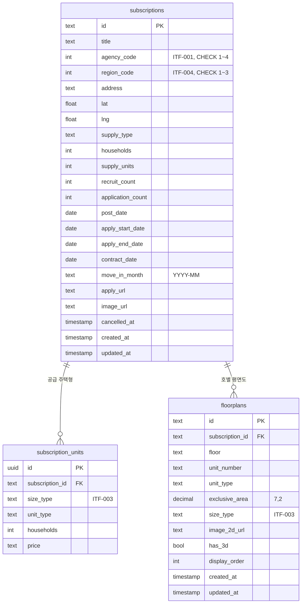

# 집보다(Zipboda) ERD 및 스키마 정의서

## 1. 문서 정보

| 항목 | 내용 |
|------|------|
| 문서명 | 집보다(Zipboda) ERD 및 스키마 정의서 |
| 버전 | v0.1.0 |
| 작성일 | 2026-10-22 |
| 기반 문서 | /docs/ZIPBODA_development-plan_v0.1.md, /src/database/schema.prisma, ../zipboda-web/docs/ZIPBODA_API 및 인터페이스 정의서_v0.1.xlsx |

### 변경 이력

| 버전 | 날짜 | 작성자 | 변경 내용 |
|------|------|--------|-----------|
| v0.1.0 | 2026-10-22 | Claude | 신규 작성 — S0~S2 범위 테이블(subscriptions·subscription_units·floorplans) 정의, 코드값 저장 규칙(ITF 정수 + CHECK), 공고 상태 계산 규칙, 개발용 시드 출처·제거 시점, 다음 스테이지 테이블 목록 |

---

## 2. 범위

개발계획서 §3.1의 ERD 산출물 중 **S0~S2(청약 조회)에 필요한 테이블**을 먼저 확정한다. 나머지 도메인은 해당 스테이지 착수 시 이 문서에 이어 붙인다.

| 상태 | 도메인 | 테이블 | 스테이지 |
|------|--------|--------|----------|
| **정의** | 청약 공고·공급 주택형·평면도 | `subscriptions`, `subscription_units`, `floorplans` | S0~S2 |
| 예정 | 회원·역할·인증 토큰 | users, social_accounts, refresh_tokens | S1 |
| 예정 | 공공데이터 동기화 이력 | sync_runs, sync_failures | S2(API-114) |
| 예정 | 관심·신청함·가점·구독 | interests, score_profiles, alert_subscriptions | S3 |
| 예정 | 3D 자산 | floorplan_assets | S4 |
| 예정 | 집구경·커뮤니티·알림·감사로그 | inspirations, posts, comments, notifications, audit_logs | S5 |
| 예정 | (2차) 상품·장바구니·주문 | products, carts, orders, payments | S6 |

---

## 3. ERD

---

## 4. 테이블 정의

### 4.1 subscriptions — 청약 공고

| 컬럼 | 타입 | NULL | 설명 | 근거 |
|------|------|:---:|------|------|
| id | text | N | 공고 식별자 | API-010/011 `id` |
| title | text | N | 공고명(단지명) | `title` |
| agency_code | int | N | 공급기관 1 LH · 2 SH · 3 GH · 4 IH | ITF-001 |
| region_code | int | N | 지역 1 서울 · 2 인천 · 3 경기 | ITF-004 |
| address | text | N | 주소 | API-011 `address` |
| lat, lng | float | Y | 지도 좌표 | API-011/012 |
| supply_type | text | Y | 공급 유형(행복주택·매입임대 등) | API-011 `supplyType` |
| households | int | Y | 총 세대수 | `households` |
| supply_units | int | Y | 공급 호수(경쟁률 분모) | `competition` 계산 |
| recruit_count | int | Y | 모집 인원 | [TBD] 정의서 필드 없음 |
| application_count | int | Y | 신청 인원(경쟁률 분자) | `competition` 계산 |
| post_date | date | Y | 공고일 | `postDate` |
| apply_start_date | date | Y | 접수 시작 | `applyStartDate` |
| apply_end_date | date | Y | 접수 마감 | `deadline` |
| contract_date | date | Y | 계약일 | [TBD] 정의서 필드 없음 |
| move_in_month | text | Y | 입주 시기(YYYY-MM) | `moveIn` |
| apply_url | text | Y | 공급기관 신청 페이지 | `applyUrl` |
| image_url | text | Y | 대표 사진 | [TBD] 정의서 필드 없음 |
| cancelled_at | timestamp | Y | 취소 시각. 취소 공고만 값이 있다 | ITF-002 취소 |
| created_at | timestamp | N | 생성 시각(기본값 now) | — |
| updated_at | timestamp | N | 수정 시각(갱신 시 자동) | — |

인덱스: `agency_code`, `region_code`, `apply_end_date`(목록 필터·마감순 정렬). CHECK: `agency_code` 1~4, `region_code` 1~3.

### 4.2 subscription_units — 공급 주택형

| 컬럼 | 타입 | NULL | 설명 | 근거 |
|------|------|:---:|------|------|
| id | uuid | N | 식별자 | — |
| subscription_id | text | N | 공고(삭제 시 함께 삭제) | — |
| size_type | text | N | 주택형 | ITF-003, API-011 `units.size` |
| unit_type | text | Y | 타입(A·B…) | `units.type` |
| households | int | Y | 공급 세대 | `units.households` |
| price | text | Y | 보증금·임대료(공고 문구 그대로) | `units.price` |

인덱스: `subscription_id`. 응답 순서는 주택형의 숫자 크기순이다(문자열 정렬은 "114"를 "39"보다 앞세운다).

### 4.3 floorplans — 호별 평면도

| 컬럼 | 타입 | NULL | 설명 | 근거 |
|------|------|:---:|------|------|
| id | text | N | 도면 식별자 | API-011 `floorplans.id`, API-031 |
| subscription_id | text | N | 공고(삭제 시 함께 삭제) | API-031 `subscriptionId` |
| floor | text | Y | 같은 도면을 쓰는 층 범위(예: "2-3") | — |
| unit_number | text | Y | 호수 | — |
| unit_type | text | Y | 타입 | `floorplans.type` |
| exclusive_area | decimal(7,2) | Y | 전용면적(㎡) | — |
| size_type | text | Y | 주택형 | ITF-003, `floorplans.size` |
| image_2d_url | text | Y | 2D 도면 이미지 | `has2d` |
| has_3d | bool | N | 3D 집구경 제공 여부 | `has3d` |
| display_order | int | N | 공고 상세가 보여 주는 순서(첫째가 기본 도면) | — |
| created_at | timestamp | N | 생성 시각(기본값 now) | — |
| updated_at | timestamp | N | 수정 시각(갱신 시 자동) | — |

인덱스: `(subscription_id, display_order)`.

---

## 5. 저장 규칙

1. **코드값은 정의서 값 그대로 저장**한다. ITF-001·ITF-004는 정수로 저장하고 DB CHECK 제약(공급기관 1~4, 지역 1~3)으로 범위를 강제한다. 정의서 코드가 바뀌면 마이그레이션을 함께 낸다.
2. **공고 상태(ITF-002)는 저장하지 않고 일정으로 계산**한다. 접수예정·접수중·마감은 `apply_start_date`·`apply_end_date`와 오늘 날짜로 정하고, 저장하는 것은 취소(`cancelled_at`)뿐이다. 일정이 없는 공고는 상태를 비운다(null).
3. **날짜 계산 기준은 한국 날짜(Asia/Seoul)**다. 서버 시간대와 관계없이 D-day·마감이 한국 날짜로 바뀐다.
4. **주택형(ITF-003)은 전용면적의 정수부**다(59.98㎡ → "59").
5. 경쟁률은 저장하지 않고 `application_count ÷ supply_units`로 계산한다(나누어떨어지면 정수, 아니면 소수 한 자리).

---

## 6. 개발용 시드

| 항목 | 내용 |
|------|------|
| 파일 | `/src/database/seed-data/subscriptions.json`, `/src/database/seed.ts` |
| 출처 | zipboda-web `src/shared/api/housing-data`(catalog·notice·geocode) + 3D 검수 목록(`src/entities/floorplan/api/models/reviewed.json`), 2026-10-22 기준 |
| 내용 | 서울 LH 현황도 9개 단지, 호별 평면도 66건(3D 20건). 공급 주택형(units)은 원천 자료가 없어 비워 둔다 |
| 실행 | `pnpm db:seed` — 여러 번 실행해도 결과가 같다. 운영(`NODE_ENV=production`)이거나 DB 주소가 로컬(localhost·127.0.0.1)이 아니면 실행되지 않는다(원격에 일부러 넣을 때만 `SEED_ALLOW_REMOTE_DATABASE=true`) |
| 제거 시점 | 공공데이터 연계(API-114)가 들어오는 PR에서 시드·seed-data를 함께 지운다(backend.rule A1) |

---

## 7. 미결 사항

| # | 항목 | 내용 | 결정 시점 |
|---|------|------|-----------|
| 1 | 공고 식별자 체계 | 시드는 단지 이름 기반 id를 쓴다. 기관 공고번호와의 매핑 방식(그대로 쓸지, 내부 id + 원천 키를 둘지) | S2 연계 착수 |
| 2 | 공급 주택형 원천 | units의 가격·공급 세대를 어떤 원천에서 받을지 | S2 연계 착수 |
| 3 | 3D 자산 형식 | 정의서(API-032)는 glTF/GLB URL, web은 평면도 JSON으로 3D를 생성한다. floorplan_assets 설계 전 결정 필요 | S4 착수 전 |
| 4 | 정의서에 없는 필드 | recruit_count·contract_date·image_url은 web 화면이 쓰지만 API-011에 없다 | 정의서 갱신 시 |
