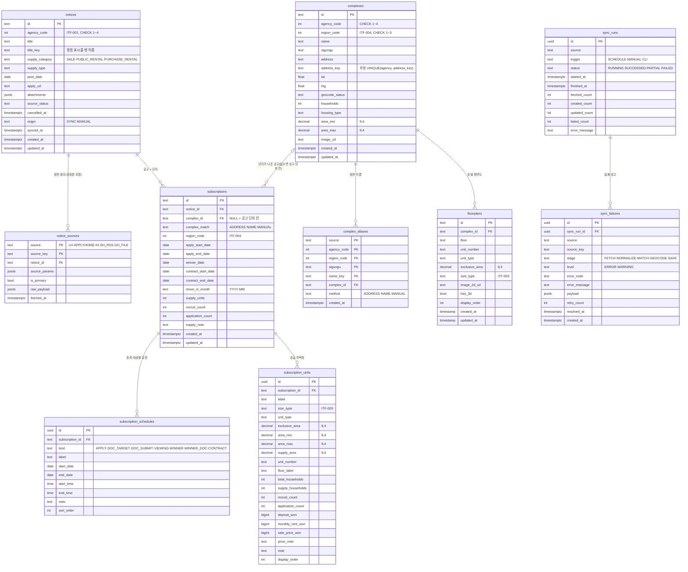

# 집보다(Zipboda) ERD 및 스키마 정의서

## 1. 문서 정보

| 항목 | 내용 |
|------|------|
| 문서명 | 집보다(Zipboda) ERD 및 스키마 정의서 |
| 버전 | v0.3.2 |
| 작성일 | 2026-10-22 |
| 기반 문서 | /docs/ZIPBODA_development-plan_v0.1.md, /src/database/schema.prisma, /docs/ZIPBODA_api-contract-delta.md, /docs/ZIPBODA_public-data-sources_v0.1.md, /docs/ZIPBODA_erd-draft_v0.1.md, ../zipboda-web/docs/ZIPBODA_API 및 인터페이스 정의서_v0.1.xlsx, ../zipboda-web/src/entities/subscription/model/types.ts |

### 변경 이력

| 버전 | 날짜 | 작성자 | 변경 내용 |
|------|------|--------|-----------|
| v0.1.0 | 2026-10-22 | Claude | 신규 작성 — S0~S2 범위 테이블(subscriptions·subscription_units·floorplans) 정의, 코드값 저장 규칙(ITF 정수 + CHECK), 공고 상태 계산 규칙, 개발용 시드 출처·제거 시점, 다음 스테이지 테이블 목록 |
| v0.2.0 | 2026-10-22 | Claude | v0.1 사용자 승인(S0 수용 기준 'ERD 승인' 충족) 반영. floorplans.exclusive_area를 decimal(7,2)→decimal(9,4)로 넓힘 — 매입임대 전용면적(14.6475㎡ 등)이 소수 넷째 자리까지 있어 반올림되던 문제(마이그레이션 widen_exclusive_area). §7 미결 4번(정의서에 없는 필드)을 계약 차이 문서로 옮기고, 미결 5번(목록 쿼리 SQL 이전 — 상태 거르기·필터 선택지는 이번에 옮기고 정렬만 남김) 추가 |
| v0.2.1 | 2026-10-22 | Claude | §2 다음 스테이지 테이블 목록을 전체 ERD 초안(/docs/ZIPBODA_erd-draft_v0.1.md v0.2.0) §7 도입 순서와 맞춤 — 상태 '예정'→'초안', S1에 권한·OTP·휴대폰 인증·약관·미디어·감사 로그, S2에 알림함·푸시 기기, S3 테이블 이름(subscription_marks·subscription_follows·alert_filters), S4 원본 PDF·평면도 모델, S5에서 알림함·감사 로그를 빼고 알림 발송·통계를 넣음. §7 미결 1·3번에 초안 권장안(source_key, D9) 연결, 미결 5번의 필터 선택지 방식을 groupBy와 상태별 존재 확인으로 고침. 기반 문서에 계약 차이 문서 추가 |
| v0.2.2 | 2026-10-22 | Claude | §7 미결 5번에 목록 응답 시간 기준선(합성 공고 1천·3천·1만 건, 동시 1·10, /test/perf) 기록 — 1만 건·동시 10에서 필터 없는 목록 P95 540~578ms로 S2 기준(≤500ms) 초과. SQL 정렬 착수 시점을 '수만 건'에서 'API-114 연계로 실제 건수 확인 시, 늦어도 5천 건 전·S2 완료 전'으로 앞당김. 필터 선택지의 면적 groupBy가 서로 다른 면적 수만큼 읽는 점 추가 |
| v0.2.3 | 2026-10-23 | Claude | §7 미결 5번(목록 정렬 SQL 이전) 해결 — 조건·정렬·페이지·건수를 DB가 하고 id 동순위는 COLLATE "C", 필터 선택지 면적은 구간별 존재 확인. 1만 건·동시 10 목록 P95 540~578ms→39~43ms, 5만 건 177~211ms 기록. 미결 6번(지도 핀 개수 — 5만 건에서 P95 1.8초, 상한·서버 클러스터링 검토, Docker Postgres shm_size 주의) 추가 |
| v0.2.4 | 2026-10-26 | Claude | §7 미결 1번(공고 식별자)·2번(공급 주택형 원천)에 공공데이터 원천 조사(/docs/ZIPBODA_public-data-sources_v0.1.md) 결과 연결 — 원천별 복합 source_key·기관 원천 우선, LH 공급정보·청약홈 주택형 오퍼레이션. 기반 문서에 원천 조사 문서 추가 |
| v0.3.0 | 2026-10-27 | Claude | **공공데이터 연계(API-114)에 맞춘 구조 개편 — 사용자 승인 대기.** LH 실데이터(서울·인천·경기 공고 999건) 조사 결과를 근거로 공고를 notices(공고)·notice_sources(원천 참조)·complexes(단지·건물)로 나누고, subscriptions를 '공고×단지 한 칸'으로 바꿈. 일정은 단지·대상마다 달라 subscriptions와 새 subscription_schedules에 둠. subscription_units를 주택형 원문·전용/공급면적·면적 구간·세대수·금액(원)·가격 안내로 재정의. floorplans를 단지(complex_id)에 붙임(같은 건물이 여러 공고에 반복). sync_runs·sync_failures 정의. 저장 규칙에 정정공고·단지 판별·날짜·금액 정규화, 면적 구간 필터 규칙 추가. 시드를 가짜 공고 없이 단지 9개·평면도 66건으로 축소. 미결 1·2번 해결, 7~11번 추가. 사용자 결정(2026-10-27): 평면도 없는 공고도 노출, 공고×단지 한 칸, 수집 범위는 분양·건설임대·매입임대, 시드는 실제 공고와 연결 후 제거 |
| v0.3.1 | 2026-10-27 | Claude | **독립 검토 반영 — 사용자 승인 대기.** ① 단지 정보가 없는 공고(경기북부 매입임대 — 주택 목록이 첨부 xlsx뿐)도 노출되게 subscriptions.complex_id를 NULL 허용으로 바꾸고 공고 단위 칸을 공고당 하나로 제한. ② 단지 판별을 이름 단독에서 '주소 우선 → 별칭' 순서로 바꾸고 complex_aliases(원천 이름 → 단지, 자동·관리자 확인 구분)를 신설. 일반명('매입다가구(경기부천시)')은 단지로 합치지 않음. 이름으로만 이어진 칸에는 평면도를 보여 주지 않음(subscriptions.complex_match). ③ 정정공고를 새 공고로 두지 않고 같은 공고에 원천 참조를 더하는 방식으로 바꿔 공고·칸 id를 유지(superseded_by_id 삭제, notices.title_key 신설, 접미어 '(정정공고)'·공백 정리 포함). ④ subscription_schedules를 종류(APPLY·DOC_TARGET·DOC_SUBMIT·VIEWING·WINNER·WINNER_DOC·CONTRACT)와 날짜·시각 분리 구조로 일반화하고, 연계시스템별 필드 대응·접수 마감 날짜와 시각이 어긋날 때의 우선순위·일정의 단지 배정 규칙을 정함. ⑤ 원천별로 덮어쓸 열을 나눔(규칙 12·13 충돌 해소). ⑥ subscription_units에 호수·층·안내 열 추가, label NULL 허용, 매핑 안 된 원문은 notice_sources.raw_payload에 보존. ⑦ complexes에 단지 전용면적 범위 추가(주택형 행이 없는 영구임대 등이 면적 필터에서 빠지던 문제). ⑧ 공급 유형 코드 → 수집 분류표(규칙 14), 행 단위 지역(규칙 15), 대표 이미지 확장자 규칙 추가. ⑨ §2.1의 '임대 03·분양 02' 서술을 연계시스템 코드 기준으로 고침(10년 공공임대가 02), '409개 중 324개'를 이름 반복으로 정정. ⑩ API 대응 표(§4.10→§4.11, complex_aliases가 §4.4에 들어가 번호가 밀림)에 빠진 필드(postDate·applyStartDate·contractDate·applyUrl·supplyUnits·recruitCount·units 세부)와 NULL 처리를 채움. ⑪ FK를 공고→칸·단지→칸·단지→평면도 RESTRICT로 바꾸고 §8 이행 순서(평면도 66건 보존)를 신설. ⑫ sync_failures에 level(ERROR·WARNING)·중복 방지 UNIQUE, sync_runs에 원천별 동시 실행 방지 추가. 미결 12~14번 추가 |
| v0.3.2 | 2026-11-02 | Claude | v0.3.1 사용자 승인(2026-11-02) 반영 — §2 '정의' 테이블 10개(notices·notice_sources·complexes·complex_aliases·subscriptions·subscription_schedules·subscription_units·floorplans·sync_runs·sync_failures)를 확정으로 표시하고 §8 이행 순서로 PR 1 마이그레이션 착수 가능. 미결 13(든든전세 포함·051 공가세대 분류)은 승인 범위에서 지금 분류표(든든전세 포함, 051 분양)를 유지하고 PR 2 착수 전 확인으로 남김. 스키마 내용 변경 없음 |

---

## 2. 범위

개발계획서 §3.1의 ERD 산출물 중 **S0~S2(청약 조회·공공데이터 연계)에 필요한 테이블**을 확정한다. 아래 '정의' 행은 v0.3.1로 사용자 승인을 받았다(2026-11-02). 나머지 도메인의 초안은 /docs/ZIPBODA_erd-draft_v0.1.md에 있고, 초안의 결정(D1~D14)이 나면 해당 스테이지 착수 시 이 문서로 옮긴다. 아래 '초안' 행은 초안 §7 도입 순서와 같다.

| 상태 | 도메인 | 테이블 | 스테이지 |
|------|--------|--------|----------|
| **정의** | 공고·원천 참조·단지·단지 별칭·목록 한 칸·일정·주택형·평면도 | `notices`, `notice_sources`, `complexes`, `complex_aliases`, `subscriptions`, `subscription_schedules`, `subscription_units`, `floorplans` | S0~S2 |
| **정의** | 공공데이터 동기화 이력·재처리 | `sync_runs`, `sync_failures` | S2(API-114) |
| 초안 | 회원·역할·인증·약관·미디어·감사 로그 | users, user_roles, role_permissions, user_permissions, admin_mfa, social_accounts, refresh_tokens, phone_verifications, password_reset_tokens, terms_versions, user_agreements, media_files, audit_logs | S1 |
| 초안 | 알림함·관리자 공고 관리(수정 보호·삭제) | notifications, push_devices, notices.locked_fields·deleted_at | S2(API-093·110~113) |
| 초안 | 관심·신청함·구독·가점 | subscription_marks, subscription_follows, alert_filters, score_profiles | S3 |
| 초안 | 평면도·3D 자산 | source_documents, floorplans 추가 열, floorplan_models, floorplan_assets | S4 |
| 초안 | 집구경·커뮤니티·알림 발송·통계 | inspirations 외 3종, community 7종, notification_templates, notification_campaigns, daily_metrics | S5 |
| 초안 | (2차) 커머스 | brands, products, product_images, product_variants, carts, cart_items, wishlists, orders, order_items, payments, payment_webhook_events, refunds, shipment_events, product_reviews, stock_movements | S6 |

### 2.1 v0.3에서 구조를 바꾼 근거 (LH 실데이터, 2026-10-27)

| 사실 | 구조에 준 영향 |
|------|----------------|
| 공고 하나에 단지가 여러 개다(영구임대 공고 하나에 단지 7곳). 매입임대는 단지 대신 건물 목록(공고당 수십~백여 동)이 온다 | 공고(notices)와 단지(complexes)를 나누고, 목록 한 칸은 공고×단지(subscriptions)로 둔다 |
| 단지·건물 정보가 API에 아예 없는 공고가 있다(경기북부 매입임대 — 공급대상주택목록이 첨부 xlsx뿐) | 단지 없는 '공고 단위 칸'을 공고당 하나 둔다(complex_id NULL) |
| 같은 단지가 여러 공고에 반복된다(같은 단지의 연도별 예비입주자 모집). 매입임대 표본 건물 이름 409개 중 324개가 2개 이상 공고에 나온다 — 단, 이것은 **이름이 같다는 뜻이고 같은 건물인지는 주소로만 확인된다** | 평면도는 공고가 아니라 단지에 붙인다(floorplans.complex_id). 단지 판별은 주소를 먼저 쓰고, 이름으로만 이은 칸에는 평면도를 보여 주지 않는다 |
| 지역만 적은 일반명이 여러 건물에 쓰인다('매입다가구(경기부천시)' 32행이 호별 주소는 모두 다름, '매입다가구(서울노원구)'). 동 이름만 있는 이름('강서화곡동')은 다른 이름의 앞부분과 겹친다 | 일반명은 단지로 합치지 않는다. 이름 판별은 완전 일치·시군구 일치일 때만 한다 |
| 같은 LH 단지가 연계시스템마다 이름이 다르다('서울공릉 신혼희망타운 행복주택' ↔ '서울공릉(복합개발) 1', 둘 다 공릉동 240-1·294세대) | 주소 정규화 키(address_key)로 먼저 판별하고, 원천 이름은 별칭(complex_aliases)으로 여러 개 둔다 |
| 접수 일정이 단지마다(영구임대 단지별 일정 7건), 대상마다(분양 특별공급·무순위·사전청약당첨자) 다르다. 서류 접수·주택 열람·당첨자 서류 제출·계약 일정도 따로 온다 | 일정을 종류·대상별 행(subscription_schedules)으로 두고, 칸에는 요약 날짜만 둔다 |
| 접수 마감 날짜와 접수 시각이 어긋난다(SBSC_ACP_CLSG_DT "2025.09.17" ↔ ACP_DTTM "~ 2025.09.16 16:00"). 시각이 "~"뿐인 일정도 있다 | 날짜와 시각을 나눠 담고, 어느 필드를 날짜 기준으로 삼을지 규칙 9에 고정한다 |
| 정정공고는 공고번호(PAN_ID)가 새로 붙고 원 공고도 그대로 남는다. 원 공고와 정정본의 게시일(PAN_DT)은 같고, 이름이 같아도 게시일이 다르면 다른 차수다. 정정 표시는 접두어 "[정정공고]"(여러 번 붙음)와 접미어 "(정정공고)" 두 가지다 | 정정본을 새 공고로 만들지 않고 같은 공고에 원천 참조를 더해 공고·칸 id를 유지한다(알림·관심·공유 링크가 끊기지 않게) |
| 같은 공고가 기관 원천(LH)과 청약홈에 이름만 달리 올라온다 | 공고 하나가 원천 참조 여러 개를 가질 수 있게 notice_sources를 둔다 |
| 필드 이름·날짜 형식은 **연계시스템 코드(CCR_CNNT_SYS_DS_CD)**마다 다르다 — 03은 LGDN_ADR·HSH_CNT·"2026.10.13", 02는 LCT_ARA_ADR·SUM_TOT_HSH_CNT·"20261008"·"2028년 07월". 임대·분양으로 갈리지 않는다(10년 공공임대가 02, 공가세대 분양·신혼희망 행복주택이 03) | 정규화 분기 기준을 연계시스템 코드로 두고 원천 코드는 notice_sources.source_params에 남긴다 |
| 주택형 표기가 "59A"·"74.9500A"·"70~80㎡"·"전용59㎡"·"2형"으로 다양하고, 주택형 없이 건물·호수·모집 인원만 오는 공급행도 있다. 금액은 숫자 또는 "공고문 참조"다 | subscription_units에 원문 표기·면적·면적 구간·호수·층·금액(원)·가격 안내를 따로 두고, 주택형이 없는 공급행은 칸의 공급 호수·모집 인원으로 합친다 |
| 단지 상세에 단지 전용면적 범위만 있고 주택형 행이 0건인 공고가 있다(영구임대 DDO_AR "21.78~29.43") | complexes에 전용면적 범위를 두고 면적 필터에 쓴다 |
| 공고의 조회 지역과 행의 지역이 다를 수 있다(인천 공고 안에 경기 부천 건물) | 지역은 행(칸) 단위로 정한다(subscriptions.region_code) |

---

## 3. ERD

---

## 4. 테이블 정의

새 테이블의 시각은 timestamptz다. 기존 floorplans의 created_at·updated_at(timestamp, UTC로 저장됨)은 초안 §6 규칙 2대로 S1 마이그레이션에서 timestamptz로 바꾼다. 새 행의 text id는 앱이 uuid v7로 만든다(초안 §6 규칙 1). FK 삭제 동작은 각 표 아래에 적고, FK 열에는 모두 인덱스를 둔다(복합 PK·UNIQUE의 첫 열이면 생략).

### 4.1 notices — 공고

공급기관이 낸 입주자 모집공고 한 건. 정정공고는 별도 행이 아니라 같은 행에 원천 참조를 더한다(§5 규칙 7). 단지·건물은 subscriptions로 잇는다.

| 컬럼 | 타입 | NULL | 설명 | 근거 |
|------|------|:---:|------|------|
| id | text | N | 공고 식별자 | — |
| agency_code | int | N | 공급기관 1 LH · 2 SH · 3 GH · 4 IH | ITF-001 |
| title | text | N | 공고명 원문(우선 원천의 최신 정정본 이름, 정정 표시 포함) | LH PAN_NM, 청약홈 HOUSE_NM |
| title_key | text | N | 정정 묶음을 찾는 이름(§5 규칙 7) | — |
| supply_category | text | N | 수집 분류: SALE · PUBLIC_RENTAL · PURCHASE_RENTAL(§5 규칙 14) | 사용자 결정 2026-10-27 |
| supply_type | text | Y | 원천 공급 유형 이름(행복주택·국민임대·공공분양(신혼희망) 등) | LH AIS_TP_CD_NM, API-011 `supplyType` |
| post_date | date | Y | 공고 게시일 | LH PAN_DT, 청약홈 RCRIT_PBLANC_DE |
| apply_url | text | Y | 공급기관 공고 상세 페이지 | LH DTL_URL, 청약홈 PBLANC_URL, `applyUrl` |
| attachments | jsonb | Y | 공고문 등 첨부 [{name, url, kind}] | LH dsAhflInfo |
| source_status | text | Y | 원천이 표시한 상태(공고중·접수중·접수마감·정정공고중). 참고용 — 상태는 일정으로 계산한다(§5 규칙 2) | LH PAN_SS |
| cancelled_at | timestamptz | Y | 취소 시각. 관리자만 지정한다 | ITF-002 취소, 초안 D8 |
| origin | text | N | SYNC(수집) · MANUAL(관리자 등록) | 초안 §5.2 |
| synced_at | timestamptz | Y | 마지막으로 원천과 맞춘 시각 | — |
| created_at·updated_at | timestamptz | N | 생성·수정 시각 | — |

CHECK: agency_code 1~4, supply_category·origin 값 목록. 인덱스: `(agency_code, title_key, post_date)`(정정 묶음 찾기), `(post_date desc)`. 관리자 수정 보호(locked_fields)·삭제(deleted_at)는 초안 D8대로 관리자 공고 관리(API-110~113)와 함께 더한다.

### 4.2 notice_sources — 공고의 원천 참조

같은 공고가 여러 원천에 있다(LH 공고가 청약홈에도, 정정본이 새 PAN_ID로도). 공고를 원천 키로 다시 찾고 다시 조회하는 데 쓴다.

| 컬럼 | 타입 | NULL | 설명 |
|------|------|:---:|------|
| source | text | N | LH · APPLYHOME · IH · SH_RSS · GH_FILE (CHECK) |
| source_key | text | N | 원천 안에서 공고를 가리키는 키. LH `{연계시스템코드}:{PAN_ID}`(PAN_ID 형식이 연계시스템마다 달라 함께 묶는다), 청약홈 `{HOUSE_MANAGE_NO}:{PBLANC_NO}` |
| notice_id | text | N | 공고 |
| source_params | jsonb | Y | 재조회에 필요한 원천 코드. LH {CCR_CNNT_SYS_DS_CD, SPL_INF_TP_CD, UPP_AIS_TP_CD, AIS_TP_CD, CNP_CD} |
| is_primary | bool | N | 값을 정하는 원천(§5 규칙 12). 공고마다 하나 |
| raw_payload | jsonb | Y | 마지막으로 받은 원천 응답(목록 행·상세·공급정보). 열로 옮기지 않은 원문(정정 사유 CRC_RSN, 공급 안내 원문 등)을 보존해 정규화 규칙을 바꿨을 때 다시 조회하지 않고 다시 처리한다 |
| fetched_at | timestamptz | Y | 마지막 조회 시각 |

PK `(source, source_key)`, 부분 UNIQUE `(notice_id) WHERE is_primary`, 인덱스 `(notice_id)`. FK notice_id → notices: CASCADE(공고와 생명주기가 같다).

### 4.3 complexes — 단지·건물

평면도가 붙는 물리적 단지·건물. 같은 단지가 여러 공고·여러 이름으로 나와도 한 행이다.

| 컬럼 | 타입 | NULL | 설명 | 근거 |
|------|------|:---:|------|------|
| id | text | N | 단지 식별자(시드 9개는 기존 id 유지 — web 3D 자산이 이 id를 쓴다) | — |
| agency_code | int | N | 공급기관 | ITF-001 |
| region_code | int | N | 지역 1 서울 · 2 인천 · 3 경기(§5 규칙 15) | ITF-004 |
| name | text | N | 단지·건물 이름(처음 받은 원천 표기. 다른 표기는 complex_aliases) | LH LCC_NT_NM·BZDT_NM·DNG_HS_ADR·LTR_UNT_NM, 청약홈 HOUSE_NM |
| sigungu | text | Y | 시군구 이름(주소가 없을 때 위치 표시·이름 판별) | LH SGG_NM, 주소의 시군구 |
| address | text | Y | 주소 원문(기본 + 상세). 매입임대 건물은 대부분 원천에 없다 | LH LGDN_ADR·LCT_ARA_ADR·ADR(+상세), 청약홈 HSSPLY_ADRES |
| address_key | text | Y | 같은 단지 판별용 주소(§5 규칙 8) | — |
| lat, lng | float | Y | 지도 좌표. 주소가 없거나 지오코딩에 실패하면 비운다 | API-011/012 |
| geocode_status | text | Y | OK · NOT_FOUND · NO_ADDRESS · MANUAL (CHECK) | — |
| households | int | Y | 단지 총 세대수 | LH HSH_CNT·SUM_TOT_HSH_CNT, `households` |
| housing_type | text | Y | 주택 유형(아파트·다가구주택·도시형생활주택 등). 응답에는 내지 않는다(§4.11) | — |
| area_min, area_max | decimal(9,4) | Y | 단지 전용면적 범위(㎡) | LH DDO_AR "21.78~29.43", MIN_MAX_RSDN_DDO_AR |
| image_url | text | Y | 대표 이미지. 이미지 파일만(§5 규칙 16) | LH dsSbdAhfl, `image` |
| created_at·updated_at | timestamptz | N | 생성·수정 시각 | — |

CHECK: agency_code 1~4, region_code 1~3, area_min ≤ area_max. 부분 UNIQUE `(agency_code, address_key) WHERE address_key IS NOT NULL`. 인덱스 `(region_code)`, `(lat, lng)`(지도 영역 — 핀 수가 늘면 미결 6에서 GiST로 바꾼다).

### 4.4 complex_aliases — 단지의 원천 이름

원천이 준 단지·건물 이름을 단지에 잇는다. 주소가 없는 행은 이 표로만 단지를 찾는다(§5 규칙 8). 관리자가 이은 연결(시드 단지 포함)도 여기에 남아 다음 수집에서 단지가 새로 생기지 않는다.

| 컬럼 | 타입 | NULL | 설명 |
|------|------|:---:|------|
| source | text | N | 원천(notice_sources.source와 같은 값) |
| agency_code, region_code | int | N | 공급기관·지역 |
| sigungu | text | N | 시군구. 원천에 없으면 빈 문자열 |
| name_key | text | N | 이름 판별 키(§5 규칙 8) |
| complex_id | text | N | 단지 |
| method | text | N | ADDRESS(주소가 같아 자동 연결) · NAME(이름으로 처음 만든 단지) · MANUAL(관리자·시드 확인) (CHECK) |
| created_at | timestamptz | N | 생성 시각 |

PK `(source, agency_code, region_code, sigungu, name_key)`, 인덱스 `(complex_id)`. FK complex_id → complexes: CASCADE.

### 4.5 subscriptions — 목록 한 칸(공고 × 단지)

API의 `/api/subscriptions/{id}`가 가리키는 단위. 목록·지도·관심(S3)·알림(S2)이 이 행을 가리킨다.

| 컬럼 | 타입 | NULL | 설명 | 근거 |
|------|------|:---:|------|------|
| id | text | N | 식별자 | API-010/011 `id` |
| notice_id | text | N | 공고 | — |
| complex_id | text | Y | 단지. 비어 있으면 '공고 단위 칸'(단지 정보가 없는 공고) | §5 규칙 6 |
| complex_match | text | Y | 단지를 정한 방법 ADDRESS · NAME · MANUAL(complex_id가 있을 때만). 평면도 노출 기준(§5 규칙 8) | — |
| region_code | int | N | 이 칸의 지역(단지의 지역, 단지가 없으면 공고 조회 지역). 목록 필터용 | §5 규칙 15 |
| apply_start_date | date | Y | 접수 시작 요약 | §5 규칙 2, `applyStartDate` |
| apply_end_date | date | Y | 접수 마감 요약 | `deadline` |
| winner_date | date | Y | 당첨자 발표 요약 | — |
| contract_start_date, contract_end_date | date | Y | 계약 기간 요약 | `contractDate` |
| move_in_month | text | Y | 입주(예정) 시기 YYYY-MM | LH MVIN_XPC_YM, 청약홈 MVN_PREARNGE_YM, `moveIn` |
| supply_units | int | Y | 이번 공급 세대·호수 합(경쟁률 분모) | 주택형 supply_households 합, 매입 LTR_SPL_RMNO |
| recruit_count | int | Y | 모집 인원 | 매입임대 QUP_CNT·CAL_QUP_CNT, `recruitCount` |
| application_count | int | Y | 신청 인원(경쟁률 분자) | 청약홈 경쟁률 REQ_CNT, `applicants` |
| supply_note | text | Y | 공급 안내(예: "금회공급 세대수는 예비자(10배수)가 포함된 세대수") | LH SPL_INF_GUD_FCTS |
| created_at·updated_at | timestamptz | N | 생성·수정 시각 | — |

CHECK: region_code 1~3, complex_match 값 목록, `(complex_id IS NULL) = (complex_match IS NULL)`, apply_start_date ≤ apply_end_date. UNIQUE `(notice_id, complex_id)`, 부분 UNIQUE `(notice_id) WHERE complex_id IS NULL`(공고 단위 칸은 공고당 하나). 인덱스 `(complex_id)`, `(region_code)`, `(apply_end_date)`, `(apply_start_date, apply_end_date)`. FK notice_id → notices·complex_id → complexes: RESTRICT(공고·단지는 지우지 않는다 — 초안 D8).

### 4.6 subscription_schedules — 종류·대상별 일정

원천이 단지·대상(특별공급·1순위·무순위·사전청약당첨자 등)마다 주는 일정을 종류별 행으로 담는다. 상세 화면의 일정과 §5 규칙 2의 요약 날짜 계산에 쓴다.

| 컬럼 | 타입 | NULL | 설명 |
|------|------|:---:|------|
| id | uuid | N | 식별자 |
| subscription_id | text | N | 목록 한 칸 |
| kind | text | N | APPLY(청약 접수) · DOC_TARGET(서류제출 대상자 발표) · DOC_SUBMIT(서류 접수) · VIEWING(주택 열람) · WINNER(당첨자 발표) · WINNER_DOC(당첨자 서류 제출) · CONTRACT(계약) (CHECK) |
| label | text | Y | 대상·순위 이름 |
| start_date, end_date | date | Y | 시작·종료 날짜(하루짜리는 같은 값) |
| start_time, end_time | time | Y | 시각(한국 시간). 원천에 시각이 없으면 비운다 |
| note | text | Y | 접수 방법 등 비고(인터넷접수·현장접수) |
| sort_order | int | N | 보여 주는 순서 |

CHECK: start_date ≤ end_date. 인덱스 `(subscription_id, sort_order)`. FK subscription_id → subscriptions: CASCADE.

원천 필드 대응(날짜·시각 우선순위는 §5 규칙 9):

| 종류 | LH 연계 03 (dsSplScdl) | LH 연계 02 (dsSplScdl) | 청약홈 |
|------|------------------------|------------------------|--------|
| APPLY | SBSC_ACP_ST_DT~SBSC_ACP_CLSG_DT, 시각 ACP_DTTM | ACP_DTTM, 대상 HS_SBSC_ACP_TRG_CD_NM | 특별공급·1순위·2순위 접수일 |
| DOC_TARGET | PPR_SBM_OPE_ANC_DT | — | — |
| DOC_SUBMIT | PPR_ACP_ST_DT~PPR_ACP_CLSG_DT | — | — |
| VIEWING | HS_VIE_ST_DT~HS_VIE_ED_DT | — | — |
| WINNER | PZWR_ANC_DT | PZWR_ANC_DT | PRZWNER_PRESNATN_DE |
| WINNER_DOC | — | PZWR_PPR_SBM_ST_DT~PZWR_PPR_SBM_ED_DT | — |
| CONTRACT | CTRT_ST_DT~CTRT_ED_DT | CTRT_ST_DT~CTRT_ED_DT | 계약 시작·종료일 |
| 단지 배정 | SBD_LGO_NM(§5 규칙 2) | — | — |
| note | — | RMK | — |

### 4.7 subscription_units — 공급 주택형

| 컬럼 | 타입 | NULL | 설명 | 근거 |
|------|------|:---:|------|------|
| id | uuid | N | 식별자 | — |
| subscription_id | text | N | 목록 한 칸 | — |
| label | text | Y | 주택형 원문 표기("59A"·"74.9500A"·"70~80㎡"·"전용59㎡"·"2형") | LH HTY_NNA·HTY_NM·HTY_DS_NM, 청약홈 HOUSE_TY |
| size_type | text | Y | 주택형(전용면적 정수부). 면적이 구간이거나 없으면 비운다 | ITF-003 |
| unit_type | text | Y | 타입(A·B…) | `units.type` |
| exclusive_area | decimal(9,4) | Y | 전용면적(㎡) | LH DDO_AR·RSDN_DDO_AR, 청약홈 HOUSE_TY |
| area_min, area_max | decimal(9,4) | Y | 전용면적이 구간으로만 올 때("70~80㎡") | LH HTY_DS_NM |
| supply_area | decimal(9,4) | Y | 공급면적(㎡) | LH SPL_AR, 청약홈 SUPLY_AR |
| unit_number | text | Y | 호수(호별 공급일 때) | LH HO_NO, `units.unit` |
| floor_label | text | Y | 층 | LH VLD_VL_NM, `units.floor` |
| total_households | int | Y | 이 주택형 총세대 | LH HSH_CNT·TOT_HSH_CNT |
| supply_households | int | Y | 이번 공급 세대·호수 | LH NOW_HSH_CNT·SIL_HSH_CNT·LTR_SPL_RMNO·GNR_SPL_RMNO, 청약홈 SUPLY_HSHLDCO+SPSPLY_HSHLDCO |
| recruit_count | int | Y | 모집 인원 | LH QUP_CNT·CAL_QUP_CNT |
| application_count | int | Y | 신청 인원(청약홈만 채운다 — §5 규칙 12) | 청약홈 경쟁률 REQ_CNT |
| deposit_won | bigint | Y | 임대보증금(원) | LH LS_GMY |
| monthly_rent_won | bigint | Y | 월임대료(원) | LH RFE·MM_RFE |
| sale_price_won | bigint | Y | 분양가(원) | LH SIL_AMT, 청약홈 LTTOT_TOP_AMOUNT(만원 → 원) |
| price_note | text | Y | 금액 대신 온 안내("공고문 참조") | — |
| note | text | Y | 신청 대상 안내(가구원 수·성별 등) | LH RQS_HSH_CNT("3~4인 가구")·SX_PP_DS_NM |
| display_order | int | N | 보여 주는 순서 | — |

CHECK: area_min ≤ area_max, 금액 ≥ 0. 인덱스 `(subscription_id, display_order)`. FK subscription_id → subscriptions: CASCADE. 응답 순서는 전용면적(없으면 구간 하한) 오름차순 → 타입 → 호수 순이다. 주택형도 호수도 없는 공급행(매입임대 건물별 DNG_HS_ADR·LTR_SPL_RMNO·QUP_CNT)은 주택형 행을 만들지 않고 칸의 supply_units·recruit_count에 더한다.

### 4.8 floorplans — 호별 평면도

| 컬럼 | 타입 | NULL | 설명 | 근거 |
|------|------|:---:|------|------|
| id | text | N | 도면 식별자 | API-011 `floorplans.id`, API-031 |
| complex_id | text | N | 단지·건물. v0.2까지는 공고(subscription_id)에 붙였다 | §2.1 |
| floor | text | Y | 같은 도면을 쓰는 층 범위(예: "2-3") | — |
| unit_number | text | Y | 호수 | — |
| unit_type | text | Y | 타입 | `floorplans.type` |
| exclusive_area | decimal(9,4) | Y | 전용면적(㎡). 매입임대는 소수 넷째 자리까지 있다 | — |
| size_type | text | Y | 주택형 | ITF-003, `floorplans.size` |
| image_2d_url | text | Y | 2D 도면 이미지 | `has2d` |
| has_3d | bool | N | 3D 집구경 제공 여부 | `has3d` |
| display_order | int | N | 상세가 보여 주는 순서(첫째가 기본 도면) | — |
| created_at·updated_at | timestamp | N | 생성·수정 시각 | — |

인덱스: `(complex_id, display_order)`. FK complex_id → complexes: RESTRICT(평면도는 손으로 추출한 자산이라 단지 삭제에 딸려 지워지지 않게).

### 4.9 sync_runs — 동기화 실행 이력

| 컬럼 | 타입 | NULL | 설명 |
|------|------|:---:|------|
| id | uuid | N | 실행 식별자(= API-114 `jobId`) |
| source | text | N | 원천(notice_sources.source와 같은 값) |
| trigger | text | N | SCHEDULE · MANUAL(관리자) · CLI |
| status | text | N | RUNNING · SUCCEEDED · PARTIAL(일부 실패) · FAILED |
| started_at, finished_at | timestamptz | N·Y | 시작·종료 |
| fetched_count, created_count, updated_count, failed_count | int | N | 가져온·새로 만든·갱신한·실패한 공고 수 |
| error_message | text | Y | 실행 전체가 실패한 사유 |

인덱스 `(source, started_at desc)`, 부분 UNIQUE `(source) WHERE status = 'RUNNING'`(같은 원천을 동시에 두 번 돌리지 않게). 실행이 비정상 종료돼 RUNNING으로 남으면 다음 실행이 시작 전에 일정 시간이 지난 RUNNING을 FAILED로 정리한다. 관리자 실행자(triggered_by)는 회원 테이블(S1)이 생기면 더한다.

### 4.10 sync_failures — 실패·경고와 재처리 큐

| 컬럼 | 타입 | NULL | 설명 |
|------|------|:---:|------|
| id | uuid | N | 식별자 |
| sync_run_id | uuid | N | 실행 |
| source, source_key | text | N·Y | 대상 원천 공고 |
| stage | text | N | FETCH · NORMALIZE · MATCH(단지·일정·정정 판별) · GEOCODE · SAVE |
| level | text | N | ERROR(공고를 저장하지 못함 — 재처리 대상) · WARNING(저장은 했고 일부 값을 비우거나 추정함 — 확인 대상) |
| error_code, error_message | text | Y | 원인 |
| payload | jsonb | Y | 실패 당시 원천 응답 — 재처리·원인 분석용 |
| retry_count | int | N | 재시도·재발생 횟수 |
| resolved_at | timestamptz | Y | 해결 시각 |
| created_at | timestamptz | N | 생성 시각 |

부분 UNIQUE NULLS NOT DISTINCT `(source, source_key, stage, error_code) WHERE resolved_at IS NULL`(같은 문제가 수집마다 쌓이지 않고 retry_count만 는다), 부분 인덱스 `(level, created_at) WHERE resolved_at IS NULL`(관리자 큐). FK sync_run_id → sync_runs: CASCADE.

### 4.11 API 응답과의 대응

web 화면 모델(/zipboda-web/src/entities/subscription/model/types.ts) 기준이다. 문자열 필드가 NULL 불가인 곳은 빈 문자열 대신 아래 대체값을 준다.

| 응답 필드(API-010/011/012) | 원천 |
|---|---|
| `id` | subscriptions.id |
| `title` | complexes.name. 공고 단위 칸은 notices.title |
| `noticeTitle`(신규) | notices.title — 계약 차이 문서에 등록(§8) |
| `agency`·`agencyLabel` | notices.agency_code |
| `supplyType` | notices.supply_type. web 목 데이터는 주택 유형(다가구주택)을 넣었지만 화면 라벨이 '공급 유형'이라 원천 공급 유형을 준다 |
| `region` | subscriptions.region_code |
| `location`(목록)·`address`(상세) | complexes.address → 없으면 '지역 시군구'(complexes.sigungu) → 공고 단위 칸은 지역 이름 |
| `coord` | complexes.lat·lng. 없으면 null(지도 핀 없음) |
| `households` | complexes.households |
| `image` | complexes.image_url |
| `sizes` | 주택형 size_type + 노출되는 평면도(§5 규칙 8)의 size_type, 중복 제거·오름차순. 구간만 있는 주택형은 넣지 않는다(필터는 §5 규칙 11로 건다) |
| `status`·`deadline`·`dday`·`applyStartDate`·`applyPeriod` | subscriptions 요약 일정 + notices.cancelled_at(§5 규칙 2·3) |
| `applicants`·`competition` | subscriptions.application_count, §5 규칙 5 |
| `moveIn` | subscriptions.move_in_month |
| `contractDate` | subscriptions.contract_start_date(~contract_end_date) |
| `postDate` | notices.post_date |
| `applyUrl` | notices.apply_url |
| `supplyUnits`·`recruitCount` | subscriptions.supply_units·recruit_count |
| `units[]` | subscription_units — `size` = size_type(없으면 null), `type` = unit_type(없으면 빈 문자열), `label`, `floor` = floor_label, `unit` = unit_number |
| `floorplans`(상세) | complex_match가 ADDRESS·MANUAL인 칸의 단지 floorplans. NAME이거나 공고 단위 칸이면 빈 배열 |
| 검색어(API-010 `q`, API-095) | complexes.name·address·sigungu, notices.title·supply_type |

대상별 일정표(subscription_schedules 전체)는 지금 web 화면에 자리가 없어 응답에 넣지 않는다. 화면이 생기면 계약 차이 문서에 더하고 낸다.

---

## 5. 저장 규칙

1. **코드값은 정의서 값 그대로 저장**한다. ITF-001·ITF-004는 정수로 저장하고 DB CHECK 제약(공급기관 1~4, 지역 1~3)으로 범위를 강제한다. 정의서 코드가 바뀌면 마이그레이션을 함께 낸다.
2. **공고 상태(ITF-002)는 저장하지 않고 칸의 요약 일정으로 계산**한다.
   - 요약 일정: apply_start_date = APPLY 일정의 가장 이른 시작, apply_end_date = APPLY 일정의 가장 늦은 종료, winner_date = 가장 이른 WINNER, contract_start_date·contract_end_date = CONTRACT의 가장 이른 시작·가장 늦은 종료.
   - 접수예정·접수중·마감은 apply_start_date·apply_end_date와 오늘 날짜로 정하고, 취소는 notices.cancelled_at으로 정한다. APPLY 일정이 없으면 상태를 비운다(null).
   - 일정의 단지 배정: 원천 일정에 단지 이름(SBD_LGO_NM)이 비어 있으면 공고의 모든 칸에 넣고, 있으면 규칙 8의 이름 키가 같은 단지의 칸에만 넣는다. 맞는 칸이 없으면 모든 칸에 넣고 WARNING(MATCH)으로 남긴다.
3. **날짜 계산 기준은 한국 날짜(Asia/Seoul)**다. 서버 시간대와 관계없이 D-day·마감이 한국 날짜로 바뀐다.
4. **주택형(ITF-003)은 전용면적의 정수부**다(59.98㎡ → "59"). 전용면적이 구간으로만 오면 주택형을 비운다.
5. **경쟁률**은 저장하지 않고 `application_count ÷ supply_units`로 계산한다(나누어떨어지면 정수, 아니면 소수 한 자리). 신청 인원이 없으면 비운다. 공급 안내(supply_note)에 예비자 포함 세대수라고 적힌 공고는 분모가 실제 공급보다 크다 — 지금은 신청 인원이 청약홈(분양)에서만 와서 겹치지 않지만, 겹치면 미결 7에서 다시 본다.
6. **목록에 올리는 칸**: 수집한 공고의 모든 칸을 올린다. 평면도가 없어도 올린다(사용자 결정 2026-10-27 — v0.2의 '평면도 있는 공고만' 규칙 폐지). 단지·건물 정보가 하나도 없는 공고는 공고 단위 칸 하나(complex_id NULL)로 올린다. 이름에 지역만 적힌 일반명 공급행(규칙 8)도 주소가 없으면 공고 단위 칸에 주택형으로 담는다. 수집 범위 밖 유형(규칙 14)은 저장하지 않는다.
7. **정정공고는 같은 공고로 합친다.**
   - title_key: 공고명에서 접두어 "[정정공고]"(여러 번 붙을 수 있다)와 접미어 "(정정공고)"를 떼고, 앞뒤 공백을 버리고 연속 공백을 하나로 줄인 값.
   - 새로 받은 원천 공고와 기관·title_key·게시일(PAN_DT)이 같은 공고가 이미 있으면 새 공고를 만들지 않고 그 공고에 원천 참조(notice_sources)를 더한다. 이름이 같아도 게시일이 다르면 다른 차수다(예: 서울번동3 행복주택 2025·2026년 모집).
   - 묶음 안에서 정정 표시가 가장 많은(같으면 공고번호가 큰) 원천을 우선 원천(is_primary)으로 두고, 공고명·일정·단지·주택형을 그 원천 값으로 다시 쓴다. 공고·칸 id는 그대로라 알림·관심·공유 링크가 정정본을 가리킨다.
   - 같은 키의 공고가 둘 이상이면 합치지 않고 새 공고로 두며 WARNING(MATCH)으로 남긴다.
8. **단지 판별**(공급행·단지 행 하나를 단지에 잇는 순서):
   - ① 주소가 있으면 address_key로 같은 기관 단지를 찾고, 없으면 새로 만든다(complex_match = ADDRESS). address_key = 시도·시군구·도로명(또는 법정동)·건물 본번-부번까지. 괄호 안 참고 항목, '일원', 동·호·층, 공백 차이는 버린다(예: "서울특별시 노원구 공릉동 240-1 일원 (서울공릉 신혼희망타운)" → "서울특별시 노원구 공릉동 240-1").
   - ② 주소가 없으면 complex_aliases에서 (원천, 기관, 지역, 시군구, name_key)로 찾는다. 별칭이 MANUAL이면 complex_match = MANUAL, 아니면 NAME이다.
   - ③ 별칭도 없으면 새 단지와 별칭(method = NAME)을 만든다(complex_match = NAME). 주소가 없는 이름으로는 주소가 있는 기존 단지에 자동으로 잇지 않는다.
   - name_key: 이름에서 앞뒤 공백을 버리고 연속 공백을 하나로 줄인 값. **완전히 같을 때만** 같은 이름이다 — '강서화곡동'과 '강서화곡동(…)'처럼 앞부분만 같은 이름이 실제로 있다.
   - 주소로 판별한 행도 이름이 일반명이 아니면 별칭(method = ADDRESS)을 남긴다. 그래서 다음에 같은 이름이 주소 없이 오면 같은 단지를 찾는다.
   - 일반명(지역만 적은 이름 — `매입다가구(경기부천시)`처럼 '매입' 유형명 + 괄호 지역)으로는 별칭을 만들지 않는다. 주소가 있으면 ①, 없으면 규칙 6의 공고 단위 칸으로 간다. 일반명 패턴은 수집기 코드에 목록으로 두고, 처음 보는 패턴이 의심되면 WARNING(MATCH)으로 남긴다.
   - **평면도는 complex_match가 ADDRESS·MANUAL인 칸에만 보여 준다.** 이름으로만 이은 단지는 같은 이름의 다른 건물일 수 있어서다. 관리자가 확인하면 별칭을 MANUAL로 바꾸고, 그 별칭으로 이은 칸의 complex_match도 MANUAL로 바꾼다.
   - 원천마다 이름 표기가 다른 단지(LH와 청약홈)는 주소로 합쳐지지 않으면 관리자가 별칭을 잇는다.
9. **날짜·시각 정규화**
   - 형식: "2026.10.13"·"20261008"·"2026-10-23" → date, "2028년 07월"·"2027.02"·"202812" → YYYY-MM, 접수 시각 "2026.09.28 10:00 ~ 2026.09.30 16:10" → 날짜와 time(한국 시간).
   - 연계 03의 APPLY 날짜는 SBSC_ACP_ST_DT·SBSC_ACP_CLSG_DT를 기준으로 한다. ACP_DTTM의 시각은 그 날짜와 같은 날일 때만 담는다. 날짜가 다르면 시각을 비우고 WARNING(NORMALIZE)으로 남긴다(예: 마감 2025.09.17 ↔ ACP_DTTM 2025.09.16 16:00 → 마감일은 09.17, 마감 시각 없음).
   - 연계 02는 SBSC_ACP_*가 없어 ACP_DTTM에서 날짜·시각을 모두 읽는다.
   - ACP_DTTM이 "~"뿐이면 시각을 비운다.
   - 읽지 못한 값은 비우고 WARNING(NORMALIZE)으로 남긴다. 공고는 저장한다.
10. **금액 정규화**: 원 단위 정수로 담는다(청약홈 분양가는 만원 → 원). 숫자가 아니면("공고문 참조") 금액을 비우고 price_note에 원문을 둔다.
11. **면적 구간 필터**(min ≤ 면적 < max, max가 없는 구간은 상한 없음): 한 칸이 구간에 들어가는 조건은 다음 중 하나다.
    - ① 주택형 전용면적이 구간 안에 있다.
    - ② 주택형 면적 구간(area_min~area_max)이 필터 구간과 겹친다(area_min < max 그리고 area_max ≥ min).
    - ③ 노출되는 평면도(규칙 8)의 전용면적이 구간 안에 있다.
    - ④ 칸에 주택형 행이 하나도 없을 때, 단지 면적 범위(complexes.area_min~area_max)가 필터 구간과 겹친다.
    - 필터 선택지(있는 구간만 보여 주기)도 같은 조건으로, 목록에 올라가는 칸에 대해서만 확인한다.
12. **원천끼리 값이 다를 때**: 값마다 정하는 원천이 있다.
    | 값 | 정하는 원천 |
    |----|-------------|
    | 공고명·유형·게시일·첨부·원천 상태·단지·일정·주택형(면적·세대·금액)·공급 안내 | 공고의 우선 원천(is_primary). 기관 원천(LH·IH 등)이 있으면 기관 원천의 최신 정정본, 없으면 청약홈 |
    | 신청 인원(칸·주택형의 application_count) | 청약홈 |
    | 단지 좌표·지오코딩 상태 | 수집기의 지오코딩(관리자가 고치면 MANUAL) |
13. **수집은 자기가 정하는 값만 덮어쓴다.**
    - 우선 원천을 다시 받으면 규칙 12에서 그 원천이 정하는 값을 원천 값으로 바꾼다. 칸·일정은 지우고 다시 만든다. 주택형은 (label, exclusive_area, unit_number)가 같은 행을 갱신하고, 없어진 행만 지운다 — 청약홈이 채운 신청 인원을 잃지 않게.
    - 원천에서 사라진 단지의 칸은 지운다. S3에서 관심·알림이 칸을 가리키게 되면 soft delete로 바꿀지 그때 정한다(미결 11).
    - 관리자가 고친 값을 보호하는 notices.locked_fields는 관리자 공고 관리(API-110~113)와 함께 더한다.
14. **수집 분류**(LH 상위 유형 UPP_AIS_TP_CD / 공급 유형 AIS_TP_CD → supply_category). 표에 없는 코드는 저장하지 않고 WARNING(NORMALIZE)으로 남겨 표를 늘린다.
    | 상위 유형 | 공급 유형(예) | 분류 |
    |-----------|---------------|------|
    | 05 분양주택 | 050 공공분양 | SALE |
    | 05 분양주택 | 051 분양주택(공가세대 등) | SALE — 임대보증금이 붙어 오는 공고가 있어 미결 13에서 확인 |
    | 39 공공분양(신혼희망) | 390 공공분양(신혼희망) | SALE |
    | 39 공공분양(신혼희망) | 063 행복주택(신혼희망) | PUBLIC_RENTAL |
    | 06 임대주택 | 060·061 공공임대(10년·50년), 062 국민·영구·통합공공임대, 063 행복주택, 065 6년 공공임대 | PUBLIC_RENTAL |
    | 13 주거복지 | 130~134·136·141 매입임대(청년·신혼·다자녀·기숙사형 등), 1315·1325 지역 매입임대, 144 든든전세 | PURCHASE_RENTAL — 든든전세는 미결 13에서 확인 |
    | 13 주거복지 | 135 매입임대 운영기관 모집 | 제외(입주자 모집이 아니다) |
    | 그 외 | 전세임대·집주인임대·상가·토지·가정어린이집 | 제외 |
15. **지역은 행 단위로 정한다**: 단지 주소의 시도, 없으면 공급행의 시도 이름(CNP_NM·SBD_CNP_NM), 그것도 없으면 공고를 조회한 지역(CNP_CD)이다. 서울·인천·경기 밖의 행은 저장하지 않고 WARNING(NORMALIZE)으로 남긴다. 공고의 나머지 행은 저장한다.
16. **대표 이미지**: 단지 첨부(dsSbdAhfl) 중 이미지 파일(jpg·jpeg·png·webp)만 image_url로 쓴다. 단지조감도라도 PDF면 attachments에만 둔다.

---

## 6. 개발용 시드

| 항목 | 내용 |
|------|------|
| 파일 | `/src/database/seed-data/complexes.json`(v0.2의 subscriptions.json을 바꿈), `/src/database/seed.ts` |
| 출처 | zipboda-web `src/shared/api/housing-data`(catalog·geocode) + 3D 검수 목록(`src/entities/floorplan/api/models/reviewed.json`), 2026-10-22 기준. 모두 LH 현황도에서 추출한 실데이터다 |
| 내용 | **단지 9개(서울 LH 매입임대 건물, 주소·좌표 포함)와 호별 평면도 66건(3D 20건), 단지마다 LH 원천 이름 별칭(method = MANUAL)** 만 둔다. v0.2 시드의 공고 정보(일정·경쟁률 등)는 web 화면용으로 맞춘 값이라 지운다(backend.rule A1) |
| 실제 공고와 연결 | LH 매입임대 공고(예: '26년 3차 청년 매입임대주택 예비입주자 모집공고', PAN_ID 2015122300020759)의 건물 행은 주소 없이 이름·시군구만 온다. 그래서 시드의 MANUAL 별칭(규칙 8 ②)으로 9개 단지에 잇고, 평면도는 단지에 붙어 있어 함께 노출된다. 별칭 이름은 PR 2에서 실제 원천 표기와 완전히 같은지 확인해 넣는다(미결 10) |
| 실행 | `pnpm db:seed` — 여러 번 실행해도 결과가 같다. 운영(`NODE_ENV=production`)이거나 DB 주소가 로컬(localhost·127.0.0.1)이 아니면 실행되지 않는다(원격에 일부러 넣을 때만 `SEED_ALLOW_REMOTE_DATABASE=true`) |
| 제거 시점 | 평면도를 관리자 화면에서 올릴 수 있게 되면(S4 API-122) 시드 대신 그 경로로 옮기고 지운다. 그 전에 운영에 평면도가 필요하면 미결 12 |

---

## 7. 미결 사항

| # | 항목 | 내용 | 결정 시점 |
|---|------|------|-----------|
| 1 | ~~공고 식별자 체계~~ **해결(v0.3)** | 내부 id + 원천 참조(notice_sources: LH `{연계시스템}:{PAN_ID}`, 청약홈 `{주택관리번호}:{공고번호}`). 공고 하나가 원천 참조 여러 개를 가진다(정정본 포함) | — |
| 2 | ~~공급 주택형 원천~~ **해결(v0.3)** | LH 공급정보 API·청약홈 주택형(Mdl) → subscription_units(원문 표기·면적·구간·호수·세대·금액·가격 안내) | — |
| 3 | 3D 자산 형식 | 정의서(API-032)는 glTF/GLB URL, web은 평면도 JSON으로 3D를 생성한다. floorplan_assets 설계 전 결정 필요. 초안 D9는 평면도 모델 JSON을 DB(jsonb, floorplan_models)에 두고 파일은 미디어로 관리하기를 권장한다 | S4 착수 전 |
| 4 | 정의서에 없는 응답 필드 | recruitCount·contractDate·image 등은 web 기준으로 API 응답에 먼저 넣었다. v0.3에서 `noticeTitle`이 더해지고 `units[].size`가 null일 수 있게 된다. 차이는 /docs/ZIPBODA_api-contract-delta.md에 모은다 | 정의서 일괄 갱신 시 |
| 5 | ~~목록 정렬을 SQL로~~ **해결(v0.2.3)** | 목록은 조건·정렬(D-day·경쟁률은 SQL 식으로 계산)·LIMIT/OFFSET·건수까지 DB가 하고, id 동순위는 `COLLATE "C"`(문자 코드 순)로 가른다. 측정(2026-10-23, 로컬, /test/perf, 동시 10, 필터 없는 목록 P95): 1만 건 540~578ms → **39~43ms**, 5만 건 177~211ms. v0.3은 notices·complexes를 조인하므로 PR 1에서 같은 도구로 다시 잰다 | PR 1 |
| 6 | 지도 핀 개수 | API-012는 영역 안의 핀을 모두 준다. 합성 공고로 서울 영역 핀 4,049개(1만 건)에서 P95 426ms, 19,877개(5만 건)에서 1.8초 — 응답 크기가 핀 수에 비례한다. 확대 단계별 상한이나 서버 클러스터링(격자로 묶은 개수)을 둘지 web 지도와 함께 정한다. v0.3에서는 같은 단지가 여러 공고에 나와 핀이 겹치므로 핀을 단지 단위로 묶을지, 좌표 인덱스를 GiST로 바꿀지도 함께 정한다. 참고: Docker로 띄운 Postgres는 /dev/shm 기본 64MB라 shm_size를 넉넉히 준다 | API-114 연계로 실제 건수가 들어올 때 |
| 7 | 정정공고 판별 규칙 검증 | §5 규칙 7은 LH 공고 999건 표본의 정정 묶음으로 세웠다. 이 표본은 이름만으로 묶었고 지역별 조회에서 생긴 같은 PAN_ID 중복을 빼지 않아 묶음 수(175개)가 부풀었을 수 있다. 수집 후 ① 같은 날 같은 이름의 정정이 아닌 다른 공고, ② 정정본 게시일이 원 공고와 다른 사례, ③ 예비자 포함 공급 세대와 신청 인원이 함께 있는 공고가 있는지 확인한다 | PR 2(LH 수집기) |
| 8 | 매입임대 건물 위치 | 대부분 건물 이름·시군구만 있어 지도 핀이 없다. 일부 공고(인천 일반 매입임대)는 호별 주소를 주므로 그 주소로 단지를 판별하고 지오코딩한다. 이름으로 지오코딩(카카오 키워드 검색)할지는 정확도를 보고 정한다 | PR 2 |
| 9 | LH·청약홈 같은 공고 잇기 | §5 규칙 12대로 기관 원천을 기준으로 두고 청약홈을 보조 원천으로 잇는 규칙(주택명·모집공고일·주소)은 청약홈 수집(PR 3)에서 실데이터로 정한다. 단지는 주소로 합쳐지는지 함께 확인한다 | PR 3 |
| 10 | 시드 단지 별칭 | 시드 9개의 MANUAL 별칭 이름이 LH 공고의 건물 이름과 **완전히 같은지**(부분 일치는 확인함) PR 2에서 확인해 넣는다 | PR 2 |
| 11 | 관심·알림이 가리키는 단위 | 초안의 subscription_marks·subscription_follows(S3)는 목록 한 칸(공고×단지)을 가리킨다. 같은 단지의 다음 공고까지 알리려면 단지 구독(complex 단위)을 따로 둘지, 원천에서 사라진 칸을 지우지 않고 soft delete로 남길지 S3 착수 때 정한다 | S3 착수 전 |
| 12 | 운영 DB의 평면도 | 시드는 운영에서 실행되지 않아, S4(API-122) 전까지 운영에는 평면도·3D가 없다. S4 전에 운영에서 3D를 보여 줘야 하면 시드와 별도로 여러 번 실행해도 같은 결과가 나오는 데이터 이관 작업을 만든다. API 호스팅 결정과 함께 정한다 | API 호스팅 결정 시 |
| 13 | 수집 분류 확인(승인 시 현 분류 유지) | ① 051 분양주택 공가세대 공고에 임대보증금이 붙어 온다 — 분양인지 임대인지 공고문으로 확인. ② 144 든든전세(LH가 매입한 주택의 전세형 공급)를 매입임대로 넣었다 — 사용자 결정의 '전세임대 제외'와 다른 유형이라 포함했다. 빼려면 규칙 14 표만 고친다 | PR 2 착수 전(사용자 확인) |
| 14 | 이름만 같은 다른 건물 | 주소 없이 이름으로 이은 칸(NAME)은 같은 이름의 다른 건물일 수 있다. 평면도를 숨겨 잘못된 3D 노출은 막았지만, 목록에서 같은 단지로 묶이는 문제는 남는다. 수집 후 호별 주소가 있는 공고로 이름 재사용이 같은 건물인지 표본을 확인한다 | PR 2 |

---

## 8. 이행 순서 (PR 1 마이그레이션)

운영 DB에는 아직 데이터가 없고(호스팅 미정), 로컬·CI DB에는 시드만 있다. 그래도 평면도 66건을 잃지 않도록 아래 순서를 지킨다.

1. notices·notice_sources·complexes·complex_aliases·sync_runs·sync_failures를 만든다.
2. 지금의 시드 공고 9행으로 complexes 9행을 만든다(id 유지, 이름·주소·좌표·세대 복사, address_key 계산). address_key 계산은 수집기와 같은 함수를 쓴다(SQL로 따로 흉내 내지 않는다 — 시드 스크립트에서 계산).
3. floorplans에 complex_id를 더해 옛 subscription_id 값으로 채우고(id가 같다) NOT NULL로 바꾼 뒤 새 FK(RESTRICT)를 건다. 그다음 옛 FK(`floorplans_subscription_id_fkey`, ON DELETE CASCADE)와 subscription_id를 지운다. **옛 FK를 지우기 전에 subscriptions를 비우면 평면도가 함께 지워진다.**
4. 옛 subscriptions·subscription_units를 지우고 새 구조로 다시 만든다(가짜 공고 데이터 제거 — 사용자 결정). subscription_schedules를 만든다.
5. CHECK·부분 UNIQUE·NULLS NOT DISTINCT·부분 인덱스는 Prisma가 만들지 못해 마이그레이션 SQL에 직접 쓴다(기존 add_code_checks와 같은 방식).
6. 목록·검색·지도·필터 선택지 쿼리를 새 조인으로 옮기고 '평면도 있는 공고만' 조건을 지운다. 필터 선택지의 면적 확인은 목록 조건과 조인한다 — 칸이 없는 단지의 평면도 때문에 눌러도 0건인 선택지가 생기지 않게.
7. /docs/ZIPBODA_api-contract-delta.md를 고친다: `noticeTitle` 추가, `units[].size` null 허용, `supplyType` 의미(공급 유형), '평면도 있는 공고만' 규칙 폐지, 검색 대상 열.
8. /test/perf로 목록·지도 응답 시간을 다시 잰다(미결 5).
